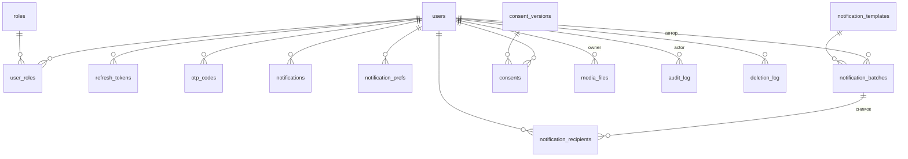
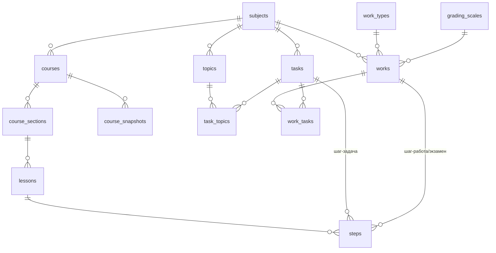
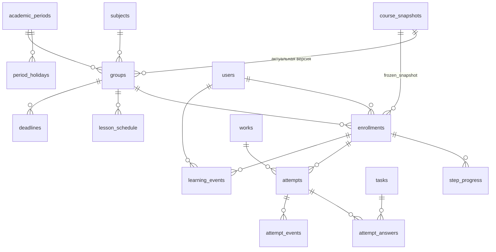
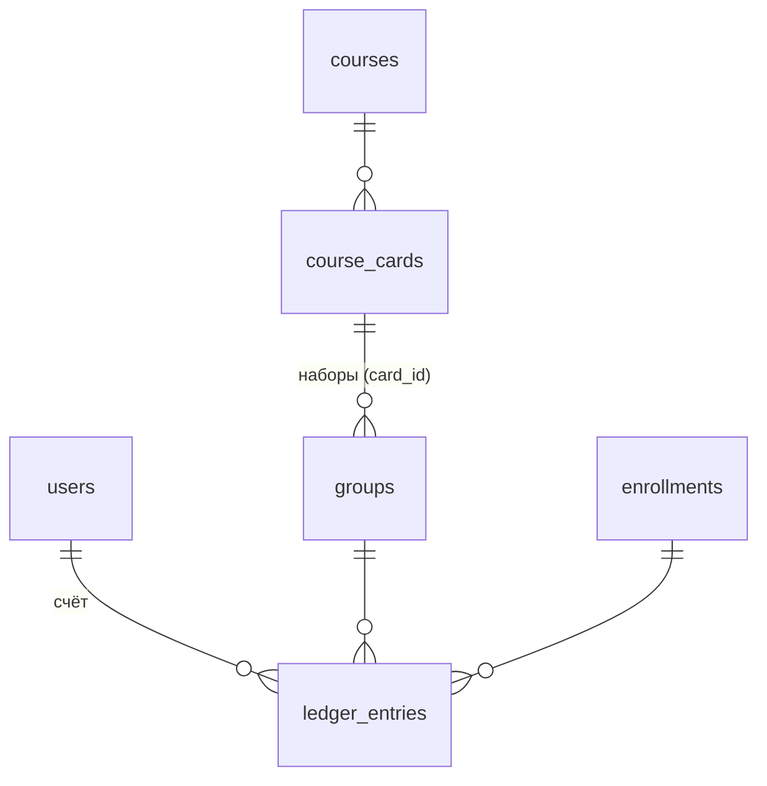

# FS-LMS 2.0 — Техническая часть (Technical Design Document)

> **Статус:** в работе. Порядок: раздел прорабатывается в обсуждении (вопросы → решения), резюме вычитывается, затем оформляется здесь. Аннотации под заголовками — рабочий план раздела, не итоговый текст; план будет уточняться.
> **Связанные документы:** `01-product.md` — продуктовая спецификация (источник требований); `03-design.md` — дизайн и интерфейсы; `04-conventions.md` — соглашения по разработке.

---

## 0. О документе

### 0.1. Назначение и порядок ведения

- Аудитория: команда разработки (1–2 человека + AI-агенты). Документ — основной справочник при реализации.
- Границы: `01-product.md` отвечает «что и зачем», этот документ — «как устроено». Продуктовые правила не дублируются, а даются ссылками.
- Крупные решения фиксируются со статусом **принято / черновик / открытый вопрос**; у принятых — краткое обоснование и отвергнутые альтернативы.
- Разработка ведётся по **Spec-Driven Development**: код пишется только по предваряющей спецификации (эти документы — верхний уровень спецификаций; процесс и шаблон фиче-спеки — в `04-conventions.md`).

---

## План документа

### Блок I — Фундамент и модульность

#### 1. Технические цели, принципы и ограничения

> **Статус: принято** (07.08.2026).

##### 1.1. Технические цели

1. **Паритет с плагином** по реально используемым сценариям — перечень по инвентаризации, не «всё, что было».
2. **Managed-поставка**: клиент получает домен и админку; развёртывание, обновления и эксплуатация — у вендора.
3. **Комплектация только конфигурацией** инстанса; код tenant-agnostic, никаких `if client == X`.
4. **Соответствие 152-ФЗ** — обязательство продукта, а не опция.
5. **API-first как дисциплина**: весь функционал доступен только через `/api/v1`, у веб-фронтенда нет привилегированных путей; авторизация работает токенами (не только браузерной сессией). Этого достаточно для подключения мобильного клиента без переработки бэкенда; push-инфраструктуру и мобильные сценарии сейчас не проектируем.

##### 1.2. Рабочие принципы

1. **Выключенный модуль не существует в наблюдаемых поверхностях**: нет роутов API, нет экранов и пунктов меню, нет прав, нет секций настроек, код модуля не загружается браузером (ленивые чанки — §4.6). Исключения — ненаблюдаемые поверхности: БД (таблицы всех модулей создаются на каждом инстансе единой цепочкой миграций и у выключенного модуля стоят пустыми) и статика фронтенда (сборка одна на весь парк — чанки выключенного модуля лежат на nginx, но не загружаются). Обоснование: единообразный парк; даунгрейд по продукту сохраняет данные — таблицы обязаны переживать выключение модуля.
2. **Минимум сложности**: при выборе между новой абстракцией и урезанием функционала — урезание, согласованное с продуктовой частью. Абстракция появляется только под живого потребителя.
3. **Языки и i18n**: все строки интерфейса — только через слой переводов, в поставке одна локаль `ru`. Ошибки API — машиночитаемые коды, тексты к ним — словарь фронтенда. Серверные логи и служебные тексты ошибок — на английском. Тексты писем и уведомлений живут в редактируемых шаблонах инстанса (продуктовое требование), в коде не хардкодятся; уведомления колокольчика рендерит фронтенд — они в слое переводов автоматически. Переключение языков, определение локали пользователя и мультиязычный контент не строим до живого рынка №2.
4. **UI из универсальных компонентов**: единая библиотека компонентов, экраны собираются из неё; без уникальных решений под отдельные экраны.

##### 1.3. Анти-scope

Не делаем осознанно: микросервисы и брокеры сообщений; shared-DB мультитенантность (один клиент = один инстанс); конструктор страниц со свободной вёрсткой; перенос PHP/jQuery-кода; мобильное приложение сейчас; LTI/SCORM-интеграции (модель держим совместимой, реализация — под живого клиента).

##### 1.4. Технологический стек

| Слой | Выбор |
|---|---|
| Backend | Python 3.12+, FastAPI, SQLAlchemy 2.0 (async), Alembic, Pydantic v2 |
| Хранение | PostgreSQL 16+ (данные, очередь задач, pub/sub — решение §2); S3-совместимое хранилище (MinIO в dev) |
| Frontend | React + TypeScript + Vite, монорепо |
| Поставка | docker-compose на инстанс |

Частные выборы зафиксированы в профильных разделах: очередь — procrastinate (§10), публичная часть — серверный рендер (§11), UI — Mantine (§11). Полный реестр зависимостей — §1.5.

##### 1.5. Реестр зависимостей

Единственный источник версий — lockfiles (`poetry.lock`, `pnpm-lock.yaml`); менеджеры пакетов: **poetry** (Python; пересмотрено с uv после покупки Astral OpenAI — 04-conventions §1.1), **pnpm** (Node). Правила: новая зависимость — только через PR с обоснованием; дублирующие друг друга библиотеки запрещены; реестр пополняется при появлении потребителя.

**Backend (runtime):**

| Библиотека | Зачем |
|---|---|
| fastapi + uvicorn | API и сервер (§1.4) |
| sqlalchemy 2 (async) + asyncpg + alembic | ORM, драйвер, миграции |
| pydantic v2 + pydantic-settings | схемы API, payload шагов, конфиг инстанса |
| procrastinate | очередь jobs поверх Postgres (§10) |
| structlog | JSON-логи (§18) |
| argon2-cffi | хэши паролей (§8) |
| authlib | OAuth привязки соцсетей (§8) |
| httpx | исходящие HTTP: ЮKassa (напрямую, без их синхронного SDK), SmartCaptcha, DaData |
| jinja2 | публичные страницы (§11.1), шаблоны писем (§14) |
| aiosmtplib | отправка почты через релей (§2.1) |
| cryptography | AES-GCM полей ЭДО (§15.2) |
| nh3 | серверная санитизация rich-text (§15.2) |
| pillow | превью изображений (§13) |
| aioboto3 | S3/MinIO (§13) |
| prometheus-client | метрики (§18) |
| sentry-sdk | ошибки в GlitchTip (§18) |

**Backend (dev):** pytest + pytest-asyncio + testcontainers (§20), polyfactory (фабрики тестовых данных), ruff (линт и формат), mypy, import-linter (§4.7), coverage.

**Frontend (runtime):** react + react-dom, react-router (§11.2), @tanstack/react-query, @mantine/* (core, hooks, forms, dates, notifications), dayjs (требование Mantine dates), i18next + react-i18next (§1.2.3), tiptap (rich-text редактор конструктора и блоков) + @tiptap/extension-code-block-lowlight + lowlight (подсветка синтаксиса в блоках кода — 01-product §5.2, §5.4; официальное расширение TipTap, отдельного инструмента не заводим — 04-conventions §1.6).

**Frontend (dev):** vite + typescript, sass-embedded (SCSS — 04-conventions §1.3), orval + msw (клиент и моки из OpenAPI — 04-conventions §1.4), eslint + typescript-eslint + eslint-plugin-boundaries (границы пакетов, §4.7), prettier, vitest, playwright (§20).

**Инфраструктура**: postgres 16+, minio, nginx, wireguard, docker + compose; контур вендора — grafana, prometheus, loki, glitchtip; dev — mailpit.

#### 2. Архитектура верхнего уровня

> **Статус: принято** (07.08.2026).

##### 2.1. Инстанс изнутри

Инстанс клиента — пять контейнеров docker-compose:

```
браузер ──► nginx ──► статика app (SPA)
              │
              └─ /api + публичные страницы ──► api (FastAPI) ──► postgres ◄── worker
                                                  │                            │
                                                  └──────► minio (S3) ◄────────┘
```

| Контейнер | Роль |
|---|---|
| `nginx` | единственная входная точка: TLS; статика `app`; публичные страницы и `/api` — прокси в `api`; путь `/s3/` — прокси в `minio` (presigned- и public-ссылки подписываются под публичный хост — иначе браузеру до хранилища не добраться) |
| `api` | FastAPI: весь функционал — только через `/api/v1` (§1.1.5) + серверный рендер публичных страниц (§11) |
| `worker` | та же кодовая база, отдельный процесс: фоновые задачи и планировщик; живёт и рестартует независимо от `api` |
| `postgres` | единственный stateful-сервис: данные, очередь фоновых задач (SKIP LOCKED), pub/sub для realtime (LISTEN/NOTIFY) |
| `minio` | S3-совместимое файловое хранилище |

**Почта.** Почтового сервера в инстансе нет — и намеренно: доставляемость решается репутацией отправляющего сервера, которую невозможно нарабатывать в каждом инстансе отдельно. Схема:

- письмо формирует worker: очередь в Postgres с ретраями и журналом `email_log`; транзакционный поток (OTP регистрации, сброс пароля — критичный путь) приоритетнее массовых рассылок;
- доставка — через **SMTP-релей вендора**: один прогретый релей на весь парк (свой сервер вендора либо коммерческий транзакционный сервис). Релей как вендорский сервис описывается в §17;
- адрес отправителя: по умолчанию — имя школы + адрес на поддомене вендора; white-label — домен клиента после настройки SPF/DKIM при провижининге (§16); полностью клиентский SMTP — опция;
- защита от спама: SPF/DKIM/DMARC, общая репутация релея, разделение потоков transactional/bulk, обработка отказов (bounce);
- в dev — Mailpit, письма наружу не уходят.

##### 2.2. Фронтенд: серверный public + SPA app

- `public` — публичные страницы LMS (каталог, карточки, статьи): серверный рендер Jinja2 из FastAPI (решение §11) — SEO для Яндекса из коробки, без Node-инфраструктуры в проде; интерактив — точечные JS-вставки поверх `/api/v1`.
- `app` — всё авторизованное одним SPA, разделённое на два пространства по аудитории (03-design §2.1): `/learn` — обучение (кабинеты ученика и представителя, плеер), `/manage` — рабочее место сотрудника; зоны разделены роутингом, layout'ами и правами; модули и тяжёлые экраны — ленивые чанки, пользователь без прав не загружает чужой код.
- Отдельный поддомен для админки при желании — конфигурация nginx с той же сборкой. Физическое выделение зоны в отдельное приложение, если появится реальная причина, — механическое: общие пакеты (`ui`, `api-client`) уже вынесены, граница проходит по папкам.

##### 2.3. Слои backend

`kernel` → `LMS-core` → `модули`:

- **kernel** — техническое ядро, домена не знает: учётные записи, роли и права, настройки, медиа, уведомления, события, аудит.
- **LMS-core** — доменный минимум базовой поставки (точную границу фиксирует карта модулей, §3).
- **модули** — всё остальное; включаются конфигурацией инстанса.

Правило зависимостей: вызовы только «вниз» (модуль → core → kernel); связь «вверх» — только события и реестры расширения; kernel и core о модулях не знают. Граница проверяется import-linter в CI (§4).

##### 2.4. Парк и вендорский контур

Парк — N одинаковых инстансов единой версии; различия между клиентами — только конфигурация. Вендорский контур (провижининг, реестр инстансов, мониторинг, SMTP-релей, биллинг подписки) — отдельная система, в продукт не входит. Здесь фиксируется только граница: инстанс отдаёт наружу health, метрики, версию и счётчик активных учеников; принимает конфигурацию комплектации. Детали — §17–18.

##### 2.5. Отвергнутые альтернативы

| Альтернатива | Почему нет |
|---|---|
| Микросервисы | команда 1–2 человека, один деплой; границы модулей держит import-linter, а не сеть |
| Shared-DB мультитенантность | изоляция данных и 152-ФЗ, простота бэкапа и удаления клиента; цена — парк инстансов, принята осознанно |
| Redis в составе инстанса | очереди, pub/sub и rate-limit на наших объёмах покрывает Postgres; вернёмся при упоре в реальный предел |
| Четыре SPA (admin/cabinet/player/public) | дублирование auth, layout и роутинга; изоляцию кода дают ленивые чанки |
| Почтовый сервер в каждом инстансе | репутация и прогрев в каждом инстансе невозможны — письма в спаме; релей вендора |
| Универсальная миграция с произвольной платформы | не предусматривается; собственный перенос банка, курсов и работ из WordPress согласован отдельно (§22) |

#### 3. Карта модулей

> **Статус: принято** (07.08.2026).

##### 3.1. Базовая поставка

Kernel + core — существует в любой комплектации: учётные записи, роли и права, регистрация с анкетой и капчей; конструктор курсов (разделы → уроки → шаги), библиотеки — банк задач и «Работы и экзамены» (автопроверяемые типы работ и шкалы оценивания); плеер, прогресс, снимки курса; группы, учебные периоды, записи на курс, расписание открытия уроков (режим «по датам»); лицевой счёт (начисления, платежи, скидки, возвраты — с ручным внесением платежей); публичные страницы LMS, информационный каталог курсов, лиды; уведомления (колокольчик + почта), медиахранилище, аудит, импорт/экспорт.

##### 3.2. Модули

| Модуль | Продуктовое имя и состав | Где | Зависит от |
|---|---|---|---|
| `campus` | Кампус: занятия, посещаемость, журнал; фичи «кабинеты», «замены», «индивидуальные занятия» | пресет У1 (без фич), У3/У4 (полный); на У2 недоступен — намеренное ограничение уровня | core |
| `manual-review` | Задания с ручной проверкой | пресет У1/У3/У4; докупается на У2 | core |
| `payments` | Онлайн-оплата: платёжный провайдер (первый — ЮKassa), чеки | пресет У2/У3/У4 | core |
| `storefront` | Витрина: самозапись, запуск наборов, покупка, транзакционный каталог | пресет У2/У4 | `payments` |
| `edo` | ЭДО: документы, договоры, приказы, сертификаты (+ DaData) | пресет У3/У4; можно выключить («У4 без ЭДО») | core |
| `school` | Школа: представители, JOIN-связывание, поля «школа/класс» | докупается на любом уровне | core |
| `ege` | ЕГЭ: позиции экзамена, пробники, шкалы перевода, плеер КЕГЭ | докупается | core |
| `code-tasks` | Интерактивные задания по программированию | докупается | core |
| `smm` | SMM / публичный контент: блог, публичный тренажёр | докупается | core |
| `marketing` | Маркетинг: промокоды, рассылки и промо-уведомления (§14), CRM-воронка, аналитика, отзывы | докупается, У2+ | core; мягко — `storefront` |
| `s3video` | S3-хранилище: видео, записи занятий, трансляции | докупается | core |
| `social-auth` | Вход через соцсети (только привязка) | докупается | kernel |
| `adsync` | AD-синхронизация | докупается, У3+ | kernel |
| `crm-erp` | CRM / ERP: зарплаты, расходы, материальные ценности | докупается, дальний срок | core |

Принятая нарезка:

- **`campus` — один модуль**: кабинеты и замены — внутренние фичи, включаемые пресетом уровня, а не отдельные модули. Одна предметная область — одна кодовая единица.
- **`payments` ≠ `storefront`**: У3 получает онлайн-оплату начислений без витрины — граница продиктована продуктом. Лицевой счёт при этом в core: на У1 работает без эквайринга.
- DaData — не модуль, включается вместе с `edo`; капча — не модуль, часть ядра.

##### 3.3. Пресеты уровней

Уровень — сущность прайса; в коде существуют только модули и конфигурация инстанса:

| Уровень | База + модули пресета |
|---|---|
| У1 | `campus` (без кабинетов/замен) + `manual-review` |
| У2 | `payments` + `storefront` |
| У3 | `campus` (полный) + `manual-review` + `edo` + `payments` |
| У4 | = У3 + `storefront` |

Пресет включает и фичи: У1 — `campus` без «кабинетов/замен» (индивидуальные занятия — по настройке инстанса, 01-product §4.2); У2 — выключенная core-фича ручного внесения платежей (§6.6); реестр допустимых схем оплаты складывается из модулей пресета (§6.6).

##### 3.4. Роль уровня в конфигурации

Уровень хранится в конфигурации инстанса только как потолок: валидация докупаемых модулей по матрице совместимости (01-product.md §2.4) и состав доступных ролей. Функциональность определяется исключительно набором включённых модулей и их фич; проверка «уровень такой-то» в бизнес-логике запрещена.

#### 4. Механика модульности и конфигурация инстанса

> **Статус: принято** (07.08.2026; дополнено 21.08.2026 — §4.7, запись против чтения на границе модуля).

##### 4.1. Модуль как кодовая единица

Backend: `app/modules/<id>/` — манифест, модели, роутер, сервисы, события. Frontend: `packages/modules/<id>/` — экраны, компоненты типов шагов; пакет зеркалит backend-модуль один в один. Kernel и core устроены так же структурно, но включены всегда.

##### 4.2. Манифест — единственная точка правды о модуле

Python-объект, декларирующий всё, чем модуль расширяет систему:

- id и зависимости от других модулей;
- атомарные права **и их вхождение в роли**: право `campus.attendance.mark` → роли «преподаватель», «адм. учебной части» — роль автоматически «худеет» при выключении модуля;
- типы шагов, пункты меню, секции настроек, типы уведомлений, поля анкеты;
- подписки на события; периодические задачи планировщика;
- внутренние фичи (`campus.rooms`, `campus.substitutions`).

Версии у модуля нет — версия одна у всего продукта (§17).

##### 4.3. Реестры расширения

Kernel и core объявляют точки расширения (StepTypeRegistry, PermissionRegistry, NavRegistry, SettingsRegistry, NotificationTypeRegistry, поля анкеты, реестр задач планировщика), модули заполняют их манифестами. Реестры собираются один раз при старте процесса из включённых модулей — никакой динамики в рантайме.

##### 4.4. Конфигурация инстанса

Файл в поставке инстанса, правит только вендор: уровень (потолок, §3.4), включённые модули с фичами и параметрами, white-label, домен, часовой пояс организации, состояние инстанса (`active / grace / admin_blocked / suspended` — §17).

- **Применение изменения** = правка конфига + перезапуск `api` и `worker`: секунды, данные и сессии целы. «Без простоя» из продукта трактуем как «без заметного перерыва и без потерь».
- **Валидация при старте — fail fast**: неудовлетворённая зависимость модулей или нарушение матрицы совместимости с уровнем → процесс не стартует с внятной ошибкой. Сломанную комплектацию нельзя довезти до клиента молча.
- Таблица `kernel.modules` хранит применённое состояние — для сводок и истории.

##### 4.5. Выключенный модуль

Не регистрируется ничего: роуты отвечают 404, права исчезают из ролей, меню и чанки не существуют для пользователя, задачи не планируются, типы шагов пропадают из конструктора. Таблицы и данные остаются (§1.2.1); шаги отключённого типа скрываются с сохранением прогресса; перед отключением владельцу показывается сводка затрагиваемого (курсы с шагами модуля и т.п.).

##### 4.6. Фронтенд-зеркало

`/api/v1/config` отдаёт включённые модули, фичи и права текущего пользователя. `app` строит меню и роуты только из этого ответа; чанки модулей грузятся лениво и только при включённом модуле. Сборка статики одна на весь парк (единая версия продукта): код выключенного модуля физически лежит на nginx, но не загружается и никуда не ведёт — изоляция на уровне загрузки и навигации, как с пустыми таблицами в БД.

##### 4.7. Принуждение границ

Backend: import-linter в CI — слои (kernel ← core ← модули) и запрет импортов между модулями вне заявленных зависимостей. Frontend: eslint-правило границ импортов между пакетами модулей. Обязательный тест: инстанс с выключенным модулем не отдаёт его эндпоинты (§20).

**Направление «вниз» разрешает не всё** (принято 21.08.2026). Разрешённого направления зависимостей мало: `payments` вправе импортировать core — и однажды начнёт активировать `lms.enrollments` своим кодом, продублировав инварианты §6.5. Граница проходит не между модулями, а между чтением и записью:

- **Запись в чужие таблицы запрещена без исключений.** Инварианты живут у владельца данных; изменение core-сущности из модуля — только через **публичный вход** `core.<домен>.api`. Контракт линтера: `modules.*` не импортирует `core.*.models` и `core.*.repository`.
- **Чтение по умолчанию — через тот же публичный вход.** Прямой read-only JOIN по чужим таблицам допустим в `repository.py` модуля-потребителя, но только **именованным контрактом в `.importlinter`**: конкретная пара «модуль → таблица», заведённая фиче-спекой и видимая в диффе PR. Это список исключений на несколько строк, а не общее послабление: сплошной запрет чтения заставил бы писать read-API под каждый JOIN и породил бы N+1 там, где хватало запроса.
- **Чужие предикаты импортируются, а не переписываются.** Если модуль определяет «активную запись» собственным условием вместо предиката владельца — это то же дублирование инварианта, но его не поймает ни линтер, ни ревью. Предикаты видимости и доменные предикаты публикует владелец, в том же `core.<домен>.api`.

Та же логика действует между модулями по заявленным зависимостям (`manifest.depends_on`); `kernel` и `core` о модулях по-прежнему не знают вовсе (§2.3), связь «вверх» — только события и реестры расширения.

### Блок II — Домен

#### 5. Модель данных

> **Статус: принято** (07.08.2026).

##### 5.1. Конвенции

- **Схема Postgres на модуль**: `kernel`, `lms` (core), далее по модулю (`campus`, `edo`, `school`, `payments`…). FK направлены только «вниз»: модуль ссылается на core/kernel и свои заявленные зависимости; из core и kernel FK в модули запрещены.
- **ID — UUIDv7**, генерирует приложение. Публичные адреса карточек и статей — слаги, не ID.
- **Naming**: snake_case; таблицы во множественном числе; PK `id`; FK `<сущность>_id`; везде `created_at` / `updated_at` (timestamptz).
- **Время**: всё в timestamptz (UTC). Пояс организации — параметр конфига инстанса: в нём вводится и отображается расписание, по нему работают фоновые задачи открытия уроков. Таймер экзамена — длительность, не момент.
- **Деньги**: `integer`, целые рубли — копеек в системе не существует (цены школ целые; дробные результаты пропорциональных расчётов — скидки в процентах, пересчёты при переводе и возврате — округляются до рубля в расчёте-предложении, которое подтверждает человек). Поля валюты нет. В API деньги — обычное целое число.
- **Статусы**: text + CHECK-констрейнт, enum живёт в коде (StrEnum/Pydantic). Нативные enum Postgres не используем — их изменение болезненно на парке.
- **JSONB — для полиморфных и структурных нагрузок**, чью схему валидирует код-владелец и по которым нет реляционных выборок: payload шага, конфигурации и ответы задач (по типу ввода), деревья снимков (§6.1), полезные нагрузки событий и уведомлений, значения настроек и комплектации, диффы аудита, шкалы «позиция → баллы». Доменные атрибуты, участвующие в фильтрах, join и ограничениях, — всегда колонки.
- **Физического удаления доменных данных нет** — статусы, архив, скрытие (по продукту); физически чистятся только технические данные (протухшие токены, обработанные события outbox). Обезличивание — отдельная операция (§15).
- **Таксономий общего вида нет** (WP-стиль «term + taxonomy» не переносится — это EAV, делающий выборки и валидацию мягкими). Вместо него два инструмента: **типизированный атрибут** (колонка или таблица модуля) — там, где на значении висит логика (позиция экзамена → `ege`, свой справочник: статистика по позициям, состав пробника; сложность задачи — закрытая шкала вендора, колонка); **справочник** — управляемый список значений с владельцем там, где значения задаёт школа (темы задач — дерево методиста со слагами, `topics`, §5.3.1). Свободного ввода меток нет нигде: он рождает «уравнения / Уравнения / ур-я», по которым не построить ни поиск, ни отчёт (01-product §5.4).

##### 5.2. Kernel (`kernel.*`) — детальные схемы

Таблиц `permissions` и `role_permissions` нет: матрица «роль → права» — вендорская поставка в коде (§4.2, §7.1); в БД — только «кто кем является». Служебные таблицы procrastinate (очередь, §10) библиотека ведёт сама.

**`users`** — учётка + базовая анкета:

| Колонка | Тип | Примечание |
|---|---|---|
| id | uuid PK | UUIDv7 |
| login | text | **UNIQUE**, вход всегда |
| email | text | вход — только для не-родительских |
| email_is_parental | bool | признак «почта родителя» (§8) |
| email_verified_at | timestamptz? | null = не подтверждена |
| password_hash | text? | проверяемый хэш; для новых паролей argon2id, при миграции совместимость с прежним паролем по §8 и §22. Импорт не требует обязательной установки нового пароля |
| status | text | CHECK: `active / blocked / anonymized` |
| last_name, first_name, middle_name | text | middle — nullable; при обезличивании заменяются (§6.8) |
| birth_date | date? | пороги 14/18 (§10) |
| phone | text? | |
| timezone | text? | переопределение пояса (§6.2); null = пояс организации |
| last_login_at | timestamptz? | |
| created_at, updated_at | timestamptz | |

Индексы: `UNIQUE (login)`; частичный `UNIQUE (email) WHERE NOT email_is_parental` (§8).

**Остальные таблицы** (по умолчанию: id uuid PK — UUIDv7, `created_at`; `updated_at` — у изменяемых; где указан иной PK — действует он):

- **`roles`** — справочник фиксированных ролей: `key text PK` (`student`, `teacher`, `methodist`, …); сидируется миграцией; нужен для FK — названия и права живут в коде (§7.1).
- **`user_roles`** — назначения: `(user_id FK, role_key FK)` PK, `granted_at`, `granted_by FK?` (null = назначила система: зачисление, JOIN-связывание — §7.3).
- **`refresh_tokens`** — состояние и ротация refresh-токенов (§8): хэш токена, пользователь, сессия устройства, отзыв, время полной авторизации и последней активности. Список устройств объединяет ротации одной сессии. Таймаут бездействия и абсолютный предел проверяются независимо; отзыв выбранной или всех сессий учитывается при последующих запросах. Это требования к модели, точные колонки, индексы и миграции фиксирует auth-фиче-спека до реализации.
- **`otp_codes`** — одноразовые почтовые коды: подтверждение/смена почты, сброс пароля и почтовый второй фактор при отсутствии подключённого приложения (§8). Требуются хэш, назначение, адресат, срок, лимит попыток и одноразовость. Секрет и использованное временное окно TOTP — отдельные требования auth-механики, не почтовый OTP. Физическая схема и ограничения уточняются auth-фиче-спекой.
- **`auth_throttle`** — состояние лимитов (§8): счётчик ошибок в окне 5 минут, ступень и пауза для пары «IP + пользователь», срок памяти ступени и сброс состояния пользователя на всех IP. Отдельно учитываются ограничения других auth-операций и пропуска капчи; они не подменяют парный счётчик неверных паролей. Доверенные IP исключаются только из предусмотренной парольной паузы. Точные ключи, колонки и согласованное обновление определяются auth-фиче-спекой; старый перечень scope только ip/account не является готовой схемой.
- **`settings`**: `(scope, key)` PK — scope = `kernel` или модуль (§4.3), `value jsonb`, updated_at, updated_by FK. Здесь же — шаблоны писем инстанса (§14) и параметры организации: рабочее время (границы календарной сетки, позже — окно отправки уведомлений). Часовой пояс организации здесь не живёт — он в конфигурации инстанса и правится только вендором (§4.4).
- **`media_files`**: `storage_key text UNIQUE`, `bucket` CHECK (`public / media / docs` — §13), mime, size_bytes bigint, `sha256` (индекс — дедупликация загрузок), original_name, owner_id FK?, module text?, `status` CHECK (`processing / ready / failed` — только у изображений, у прочих сразу `ready`), `variants jsonb?` (ключи и размеры производных, §13). Физически не удаляются (§5.1).
- **`notifications`**: user_id FK, type (ключ реестра §14), payload jsonb, read_at?. Частичный индекс `(user_id) WHERE read_at IS NULL` — счётчик непрочитанного.
- **`notification_prefs`**: `(user_id, type, channel)` PK, enabled bool. Строка — только при отклонении от дефолта типа; нет строки = дефолт из реестра.
- **`notification_templates`** (§14): `class` CHECK (`service / promo`), name, subject, body (простой текст с переменными), created_by FK, updated_at. Стартовый набор сидируется при провижининге (§16).
- **`notification_batches`** (§14): автор FK, `class` CHECK (`service / promo`), template_id FK?, subject, body, `status` CHECK (`queued / sending / sent / failed`), recipients_count int, skipped_count int (отсеяны колпаком или отсутствием согласия), sent_at?.
- **`notification_recipients`**: `(batch_id, user_id)` PK, `state` CHECK (`delivered / skipped_no_consent / skipped_cap`), notification_id FK? — **снимок получателей**: кому ушло на момент отправки (01-product §4.10.1); append-only, живёт бессрочно.
- **`outbox_events`**: event_key, payload jsonb, occurred_at, `published_at?` («разослано в очередь», не «обработано»). Частичный индекс `WHERE published_at IS NULL` (§10) — по нему работает релей; разосланные чистятся по retention. Состояния доставки здесь нет: единица доставки — пара «событие × подписчик», её счётчик попыток и последняя ошибка живут в задачах procrastinate (§10).
- **`audit_log`** (append-only): actor_id FK?, actor_role, `area` (функциональная область §7.3), action, object_type, object_id?, diff jsonb?, `is_off_profile bool` (вмешательство непрофильной роли), `is_vendor bool`, ip. Индексы: `(object_type, object_id)`, `(actor_id, created_at)`.
- **`email_log`**: to_email, template, status CHECK (`queued / sent / failed / bounced`), error?, sent_at?. Индексы: (to_email), (status).
- **`email_suppression`** — стоп-лист адресов: `email text PK`, reason CHECK (`bounce / complaint / unsubscribe`). Синкается с релея (§17); отправка на эти адреса блокируется до ручного снятия — защита репутации (§2.1).
- **`modules`**: `module text PK`, enabled bool, features jsonb, updated_at — применённая комплектация (§4.4).
- **`deletion_log`**: user_id (обезличенная учётка), original_login, original_name, original_email, original_phone, performed_by FK. Доступ — отдельное право владельца (§6.8); выгружаемый.
- **`consent_versions`** — версионируемые тексты согласий и оферты (§15.2; 01-product §7): `kind` (ключ реестра: `registration` — ядро; документальные виды добавляет `edo`, рекламное — `marketing`), `version int`, body, published_at. Редакция неизменяема — правка это следующая версия.
- **`consents`** — акцепты: user_id FK, version_id FK, accepted_at, ip. Акцепт навсегда остаётся на своей версии (01-product §7).

**ER-диаграмма** (без изолированных таблиц — `settings`, `modules`, `outbox_events`, `email_log`, `email_suppression`):



##### 5.3. Core (`lms.*`)

Состав по областям; доменные механики уточняют подразделы §6:

- **Контент** — детальные схемы в §5.3.1. `subjects` — обязательный верхний уровень группировки для курсов, групп и банка задач. Предмет — не «школьный предмет», а пространство контента: для ЕГЭ-школы это «Информатика», для школы маникюра — «Маникюр»; категория карточки в каталоге — отдельное поле карточки и с предметом совпадать не обязана. Обязательность держит системные инварианты («группа и курс одного предмета», область банка задач, фундамент модуля ЕГЭ) безусловными.

##### 5.3.1. Контент и библиотеки — детальные схемы

**`subjects`**: id PK, `name text UNIQUE`, is_archived bool, `default_input_type text?` — **тип ввода ответа по умолчанию для новых задач банка** (01-product §5.4): в предмете «Программирование» это `code`, и методист не выбирает его вручную каждый раз. Только предзаполнение формы создания задачи — на существующие задачи не влияет и ничего не ограничивает. Значение валидируется по реестру включённых модулей, как `steps.type` (§6.3): модуль выключен — пресет игнорируется, форма открывается с типом по умолчанию.

**`courses`**: id PK, subject_id FK, title, status CHECK (`draft / composed / archived`), created_by FK. Витринные поля (описание, обложка, цена) здесь не живут — всё в карточке (01-product.md §8.1).

**Структура** — три таблицы с одинаковыми служебными полями (`position int`, `is_hidden bool` — скрытие вместо удаления, §5.1):

- **`course_sections`**: course_id FK, title;
- **`lessons`**: section_id FK, title;
- **`steps`**: lesson_id FK, `title` (тема шага — заголовок первого уровня на странице шага, 01-product §5.2; у ссылочных типов подставляется из `tasks`/`works` при выборе и дальше правится вручную), `type` (ключ реестра §6.3), `payload jsonb` (настройки типа — лимит попыток и т.п.; валидирует модуль-владелец), `attachments jsonb` (массив media_id — файлы-материалы лекции, порядок = порядок массива; сами файлы в `kernel.media_files`, как у `tasks.attachments`; непусто только у типа `text`), `copy_pending bool` (шаг создан импортом и содержимое ещё не правили — 01-product §5; снимается при первом сохранении payload или вручную); для базовых ссылочных типов — явные `task_id FK?` («задача») и `work_id FK?` («работа»/«экзамен»), согласованность с `type` — CHECK. На этих колонках держится обратный поиск «где используется» (§6.9); модульные типы шагов держат свои ссылки в таблицах своих схем (FK «вниз» разрешён).

**`course_snapshots`** (§6.1): id PK, course_id FK, `version int` (порядковый в рамках курса), `tree jsonb` — дерево `{разделы: [{id, title, уроки: [{id, title, шаги: [{id}]}]}]}`: ссылки на живые id + копии названий; append-only. Индекс (course_id).

**`tasks`** (банк задач): id PK, subject_id FK, `title text?` — название задачи: свободный текст методиста, без формата и уникальности (01-product §5.4; личная нумерация каждого — «1.2. П-1-1», «1.2.33» — обе валидны), не путать с вычисляемым номером позиции в работе (`works.task_prefix` + `work_tasks.position`, ниже); пусто — задача узнаётся по превью `statement`, `input_type` CHECK (шесть типов §6.3), `statement` (rich text, санитизирован — §15.2), `answer_config jsonb` (эталоны/варианты/пары по типу), `difficulty` CHECK (`easy / medium / hard`, nullable) — закрытая шкала вендора (01-product §5.4), status (`active / archived`), created_by, `attachments jsonb` (массив media_id — файлы «скачай и реши», сами файлы в `kernel.media_files`).

- **`topics`** — справочник тем (дерево по предмету; ведёт методист своего предмета, добавить термин может и администратор — 01-product §5.4): id PK, subject_id FK, `parent_id FK?` (self), name, `slug text UNIQUE` (адрес публичного тренажёра — заводится сразу, до подключения модуля `smm`), position;
- **`task_topics`**: `(task_id FK, topic_id FK)` PK — темы задачи: поиск и фильтры банка, подбор в работу.

**`work_types`** — фиксированный набор пяти типов: опрос, самостоятельная, практическая, домашняя, контрольная. Короткая метка служит для журнала, признак `is_final` — для агрегатов успеваемости. Опрос ограничивает состав заданий, практика предоставляет самопроверку. Поведение связано с устойчивым типом, независимо от отображаемой подписи. Экзаменационные станции ЕГЭ/ОГЭ доступны только при соответствующей конфигурации предмета.

**`works`** (работы и экзамены): id PK, subject_id FK, `mode` — **режим проведения, ключ реестра режимов** (по образцу `steps.type`, §6.3; «закрытый вендорский» — в смысле «школа режимы не изобретает», 01-product §5.2): core регистрирует `inline` (все задания на странице шага, оценка за работу целиком) и `timed` (отдельная страница обычной работы с таймером и лимитом попыток из её настроек); модуль экзаменов добавляет станции ЕГЭ/ОГЭ для экзаменационных предметов. CHECK-констрейнта нет — валидация по реестру включённых модулей, как у типов шагов. Далее: title, `work_type_id FK?` — **тип работы** из фиксированной пятёрки (метка журнала, признак итоговости, поведение по типу); контрольная бывает и `inline`, и `timed`. Затем `attempts_limit int?` (null = безлимит; у экзаменационной станции всегда 1 — §6.4), `time_limit_minutes int?` (обязателен при `timed`/`ege`), `result_visibility` CHECK (`immediate / after_review`), `tab_log bool`, `grading_scale_id FK?` (null = 1 балл/задание), `task_prefix text?` — **префикс нумерации заданий** (01-product §5.3): непусто — номер задания собирается как `{task_prefix}-{position}` («1.3. П-2» + 3 → «1.3. П-2-3»), пусто — «Задание N». Строка отображения, на `work_tasks.position` и шкалу баллов не влияет; собирается на клиенте из тех же данных везде, где задание называют (плеер, экзамен, очередь проверки). Далее status CHECK (`active / archived`), created_by.

**`work_tasks`**: (work_id FK, task_id FK) PK + `position int`, `UNIQUE (work_id, position)` — позиция входит в шкалу баллов, поэтому уникальна и блокируется от правок при наличии сдач (§6.9); по той же причине блокируется и перетаскивание (смена `position`) в конвейере конструктора работы, ниже. **Инварианта «задача того же предмета, что работа» здесь намеренно нет** (принято 31.08.2026) — в отличие от `groups` («курс того же предмета», выше): задача домашним предметом определяет своё дерево тем, права правки и позицию ЕГЭ, но использоваться в работе/курсе другого предмета может свободно, ссылкой (01-product §5.4). Не чинить как «забытую валидацию».

**Конвейер конструктора работы** (01-product §5.4, принято 31.08.2026): единственный путь создания задачи, где карточка становится настоящей записью `tasks` + `work_tasks` не по явному «Сохранить», а в момент заполнения обязательных полей (условие + ответ) — сервисный слой транзакционно создаёт `tasks` со статусом `active` и строку `work_tasks` с очередной `position`; закрытие карточки (авто по заполнению или кнопкой «+») на данные не влияет, только на состояние UI (раскрыта/схлопнута). Перетаскивание карточек — `UPDATE work_tasks.position`; `tasks.title`, если задан, не пересчитывается при смене позиции (выше) — только вычисляемый номер («1.3. П-2-3») следует за позицией, он и так не хранится.

**Проверка на дубли при ручном создании** (принято 31.08.2026, отменяет прежнее «дедупликации при ручном создании нет» — ниже): мягкая, не блокирующая, срабатывает в момент сохранения задачи (создание строки `tasks` в конвейере или дровере), а не по мере набора текста. Ключ совпадения — **пара** `statement` + `answer_config` (нормализованный текст условия и сериализованный эталон ответа), а не одно условие: задачи с одинаковым текстом, но разными файлами или эталоном (нормальный случай для вариантов) не считаются ложными дублями. Поиск — **по всей школе, без ограничения `subject_id`** (01-product §5.4): именно попадание одной и той же задачи в банки разных предметов — типичный случай, который проверка обязана ловить, предметный скоуп его пропустил бы по определению. При совпадении — предупреждение с превью найденной задачи (и её предметом, если отличается от текущего), создание не блокируется.

**`grading_scales`**: шкалы настраиваются в контексте экзаменационного предмета, выбираются экзаменом и фиксируются в его снимке. Содержат правила баллов и соответствующую таблицу перевода; конкретные связи с предметом и редакциями уточняются фиче-спекой. Временное объединение задач одного номера в одну единицу зачёта из WordPress не переносится.


- **Учебный процесс** — детальные схемы в §5.3.2.

##### 5.3.2. Учебный процесс — детальные схемы

**`academic_periods`**: id PK, name, date_start, date_end, `closed_at?` (ставится операцией закрытия — §6.8). Поля «текущий» нет — состояние вычисляется из дат (будущий / текущий / прошедший; закрытый — по `closed_at`): параллельная работа с несколькими периодами (набор в текущий и следующий триместр, подготовка курса на будущий семестр) — норма, никакой «активации» периода не существует; умолчания фильтров по сегодняшней дате — забота UI. **`period_holidays`**: id PK, period_id FK, date_start, date_end, name?.

**`groups`**: id PK, subject_id FK, period_id FK? (null — вечные и индивидуальные), name, course_id FK?, `snapshot_id FK?` (актуальная версия снимка, §6.1), teacher_id FK?, `payment_scheme` CHECK (`onetime / monthly / per_session`), `price int?` (null = бесплатно), self_enroll bool, capacity int?, `schedule_status` CHECK (`draft / approved`, §6.2), `is_individual bool` (для агрегированного календаря индивидуальных занятий), status (`active / archived`). Инвариант «курс того же предмета» — сервисная валидация. Регулярность — в `campus` (§6.2).

**`enrollments`** (§6.5): id PK, user_id FK, group_id FK, **`UNIQUE (user_id, group_id)`** (повторное зачисление = реактивация той же записи), status CHECK (`awaiting_payment / active / completed / terminated / cancelled`), source CHECK (`admin / self / purchase / edo / import`), `frozen_snapshot_id FK?` (§6.1), terminated_reason?, terminated_at?, completed_at?.

**`lesson_schedule`** (§6.2): PK `(group_id, lesson_id)`, state CHECK (`open_now / scheduled / unscheduled`), opens_at?, `opened_at?` (факт открытия, не откатывается).

**`deadlines`** (§6.2): id PK, group_id FK, step_id FK, due_at, after_policy CHECK (`close / late`); `UNIQUE (group_id, step_id)`.

**`step_progress`** (§6.3): PK `(enrollment_id, step_id)`, status CHECK (`in_progress / completed` — «исчерпан лимит попыток» тоже даёт completed, 01-product §5.2), score int?, attempts_count int, `data jsonb` (ответы шага-задачи), completed_at?.

**`attempts`** (§6.4): id PK, enrollment_id FK, step_id FK, work_id FK, started_at, deadline_at?, finished_at?, finish_reason? CHECK (`manual / auto_timeout`; null у активной попытки), score int?, status CHECK (`active / completed / invalidated`). Для выданных работ активная попытка уникальна в пределах записи ученика и выдачи. Для остальных шагов — в пределах записи и шага. «Одна попытка экзамена» — сервисный инвариант (пересдача — через `invalidated`, §6.4).

- **`attempt_answers`**: PK `(attempt_id, task_id)`, answer jsonb, is_correct?, score?, answered_at — автосохранение (§6.4);
- **`attempt_events`**: id PK, attempt_id FK, type (`blur / focus`), at — лог вкладок (опция экзамена).

**`learning_events`** (лента учебных событий): id PK, user_id, enrollment_id?, verb, object_type, object_id, context jsonb, occurred_at. Индексы: (enrollment_id), (user_id, occurred_at). Append-only, живёт вечно — фундамент журнала, сводок и выгрузки использования доступа (§6.6).



Кампус-таблицы (занятия, регулярность, посещаемость, замены) — модульные: детализируются фиче-спекой кампуса, эскиз — в §6.2. `teacher_id` — в core-группе, хотя функции преподавателю дают модули: поле нужно трём модулям сразу (кампус, ручная проверка, преподаватель набора на витрине), расширение тремя таблицами — сложность без выгоды; видимость поля в UI определяют модули. Кабинет — в `campus`.
##### 5.3.3. Деньги — детальная схема

Сущности «лицевой счёт» в БД нет: счёт ученика — проекция по `user_id`, баланс — сумма операций. Механика — §6.6.

**`ledger_entries`** (append-only — без `updated_at`):

| Колонка | Тип | Примечание |
|---|---|---|
| id | uuid PK | |
| user_id | FK | чей счёт |
| type | text | CHECK: `charge / payment / discount / refund` |
| amount | int | всегда положительное; знак задаёт тип |
| basis | text? | CHECK: `course / month / session`; обязателен у начислений, null у остальных типов |
| group_id | FK? | обязателен у начислений и скидок; у платежей и возвратов заполняется при разнесении по начислениям групп (§6.6) — отчётность «сколько поступило по набору»; null допустим только у авансового платежа без начислений и возврата переплаты — сервисная валидация |
| enrollment_id | FK? | |
| month | date? | первое число месяца — для помесячных |
| source_type + source_id | text? + uuid? | слабая ссылка на занятие (§6.6 — FK из core в `campus` запрещён) |
| method | text? | у платежей: `manual / provider` |
| provider_payment_id | text? | ссылка на платёж провайдера (§12) |
| reversal_of | FK? self | сторно (§6.6) |
| reason | text? | обязателен у скидок, корректировок и возвратов — сервисная валидация |
| created_by | FK? | null = система (генерация начислений) |

Индексы: `(user_id, created_at)`, `(group_id)`, `(enrollment_id)`. Идемпотентность помесячной генерации — сервисная проверка «существует несторнированное начисление месяца» (уникальным индексом не выразить из-за сторно-цепочек).

##### 5.3.4. Публичная часть — детальные схемы

**`course_cards`** (01-product.md §8.1): id PK, course_id FK, `slug text UNIQUE` (ЧПУ — §11.1), title, description (rich text, санитизирован), cover_media_id FK?, category?, audience?, requirements?, `volume_hours int?` + `volume_auto bool` (автоподсчёт из содержимого с ручной правкой), `base_price int?`, `certificate bool` (показ поля управляет модуль `edo` — как с `teacher_id` группы), `published bool` (публикация в каталог — отдельное действие с чек-листом, §8.2 продукта). Метки готовности — пять вычисляемых состояний («В разработке» → «Ожидает описания» → «Ожидает набора» → «Готова к публикации» → «Опубликована», 01-product §8.1), не хранятся.

**Дополнение к `groups`**: `card_id FK?` — принадлежность набора-потока карточке (история наборов «под карточкой»); инвариант «максимум один открытый набор на карточку» — сервисный. Несколько карточек одного курса — через `course_id` карточки.

**`leads`** (01-product.md §4.7): id PK, name, contact (как ввёл посетитель), comment?, direction? (справочное пожелание), status CHECK (`new / in_progress / closed`), `utm jsonb?` (пишется пассивно в ядре, чтобы данные не терялись до покупки модуля «Маркетинг»; анализ — только модулем), processed_by FK?, created_at. CRM-воронка (канбан, ответственные, касания) — таблицы модуля `marketing` поверх.



##### 5.4. Данные модулей

Схемы: `campus` (занятия, кабинеты, посещаемость, замены), `edo` (документы с шифрованными полями, договоры, приказы, сертификаты; документальные согласия и оферта — поверх core-механизма версий: сам механизм — в ядре, см. §5.2 `consent_versions`, потому что регистрационное согласие версионируется на всех уровнях — §15.2), `school` (связи представитель ↔ ученик, JOIN-ссылки), `payments` (платёжные намерения, чеки, вебхуки), `manual_review` (критерии, сдачи, проверки), `ege`, `smm`, `marketing`, `s3video`, `code_tasks`, `social_auth`, `adsync`, `crm_erp`. Детализируются в фиче-спеках модулей по SDD (§0.1); правило одно: FK только вниз. ER-диаграммы добавляются точечно при проработке механик §6.

#### 6. Ключевые доменные механики

##### 6.1. Снимок курса

> **Статус: принято** (07.08.2026).

**Граница «структура vs содержимое».** Снимок фиксирует структуру: дерево разделов → уроков → шагов (состав, порядок), названия разделов и уроков. Живым — общим для всех групп — остаётся содержимое: payload шага, задачи по ссылке на банк. Исправление опечатки видно всем сразу; изменение состава и порядка — никому, пока снимок группы не обновлён явно.

**Модель: неизменяемые версии, JSONB-дерево.** `course_snapshots`: `id`, `course_id`, `created_at`, `tree` (JSONB) — дерево со ссылками на живые `lesson_id` / `step_id` плюс копии названий и флагов обязательности. Снимок создаётся один раз и не правится (append-only); «обновить снимок» = создать новую версию и переключить группу. Ссылки на живые сущности вечно валидны — физическое удаление контента запрещено (§5.1). Прогресс и расписание ссылаются на живые `step_id` / `lesson_id`; снимок определяет, какие из них существуют для группы и в каком порядке.

**Жизненный цикл.** Снимок создаётся при назначении курса группе (в КТП) и при запуске набора с витрины — это одна операция. Группа всегда указывает ровно на одну версию.

**Диагностика форм приёма.** Клиентские события заявки и JOIN-анкеты связаны случайным идентификатором визита; серверные запросы отправки дополнительно связываются с `trace_id`. Записываются вид формы, этап, время, имена полей с ошибками и безопасные коды причин, успешная отправка или наблюдаемый уход без отправки. Уход может не доставиться при закрытии браузера или обрыве связи: отсутствие успешной отправки само по себе не доказывает уход, интерфейс не показывает его как достоверный факт. Успех фиксируется по подтверждённому сервером результату. Значения полей, полные URL с JOIN-токеном, документы, пароли, OTP и тела запросов исключаются, включая диагностические сообщения. Клиентские события не меняют состояние заявки и не служат подтверждением заполнения; просмотр соблюдает права на журналы и область инстанса.

**Срок заявки.** Сервер проверяет срок незавершённой заявки — 20 дней от подачи. Завершение анкеты представителем фиксируется отдельно и прекращает автоматическое истечение заявки. Фоновая обработка истечения повторно проверяет, что анкета ещё не заполнена, и согласована с её отправкой. Временный доступ к группе проверяет итоговое состояние заявки. Срок JOIN-токена в 72 часа проверяется независимо от срока самой заявки.

**Подсказки школ.** Модуль `school` использует справочник школ с поиском по названию и номеру в настроенном регионе организации. Выбранная запись сохраняет связь со справочником, ручной ввод сохраняется без такой связи. Доступность функции не зависит от подключения ЭДО или DaData. Источник справочника и способ обновления определяются в фиче-спеке; отсутствие записи или недоступность подсказок не блокируют ручной ввод и отправку заявки.

**Восстановление из архива.** Операция повторно использует существующие идентификаторы человека, учётные записи и связи семьи; создаёт только отсутствующие учётные записи штатным механизмом приглашения. Повтор запроса не создаёт дублей. Неоднозначное сопоставление архивной записи с существующим пользователем требует проверки сотрудником. История прежних записей на курсы сохраняется; восстановление не меняет их статусы и само по себе не выдаёт учебный доступ. Действие проверяет права сотрудника и фиксируется в журнале.

**Создание доменной учётной записи (`adsync`).** При включённом модуле источник подачи заявки проверяется по настроенной сети офиса, с серверным определением адреса и доверенной цепочкой прокси. Совпадение запускает создание автоматически; иначе операция доступна уполномоченному сотруднику из заявки. Состояние операции связано с заявкой и пользователем: в очереди, создана, отклонена офисным сервером. Повтор запроса не создаёт второго доменного пользователя. Эта операция не создаёт запись на курс, не выбирает учебную группу и не выдаёт временный доступ. Конкретный транспорт связи с офисом и защищённая доставка учётных данных определяются отдельной фиче-спекой модуля; правило единого логина и пароля описано ниже. Действия и результат журналируются без паролей и других секретов.

**Параметры создаваемой доменной учётной записи.** Создание включает настройку пути перемещаемого профиля по конфигурации офисного домена и признак отсутствия обязательного истечения пароля. Эти настройки применяются к создаваемой интеграцией учётной записи ученика, не меняют политику всего домена и не отменяют операции смены пароля. Путь определяется настройками модуля и идентификатором пользователя, не произвольным вводом из публичной заявки. Частичное применение не объявляется полностью успешным созданием; повтор завершает настройку той же учётной записи без дублей. Конкретное отображение параметров в атрибуты AD определяется фиче-спекой.

**Синхронизация учётных данных (`adsync`).** При создании доменной учётной записи используются логин и пароль ученика из LMS. Операции смены и административной выдачи пароля инициируют обновление доменного пароля. Успех локальной смены пароля в LMS не объявляет синхронизацию завершённой: домен подтверждает применение отдельно. Если пароль изменён несколько раз до доставки, устаревшая операция не должна перезаписать более новый пароль. Хэш LMS не используется как доменный пароль и не позволяет восстановить исходный пароль. Получение секрета при отложенном создании доменной учётной записи и его защищённая доставка описываются до реализации отдельной фиче-спекой; модуль не вводит постоянную обратимую копию всех паролей. Открытые пароли исключены из очередей и журналов; временные защищённые данные доставки имеют ограниченный срок и удаляются после применения или отмены.

**Очередь AD-синхронизации.** Операции доставки офисному серверу используют общий надёжный механизм очередей (§10). Временная недоступность вызывает повтор с увеличением интервала; намерение выполнить операцию сохраняется при перезапуске. Потеря ответа не означает отсутствие результата: повтор проверяет состояние и не создаёт дублей. До исполнения проверяется актуальное требуемое состояние пользователя, чтобы устаревшее отключение не отменило последующее зачисление. После исчерпания автоматических попыток операция остаётся видимой как требующая внимания и доступна для повторного запуска по правам; успешное завершение показывается только после подтверждения офисного сервера. Ожидание связи отличается от окончательного отказа. Задачи и диагностические записи не содержат открытых паролей или иных секретов; способ доставки секретов определяется отдельной фиче-спекой.

**Жизненный цикл доменной учётной записи (`adsync`).** При прекращении обучения модуль проверяет все действующие направления ученика: отключение запрашивается только после прекращения последнего. При повторном зачислении запрашивается включение ранее связанной доменной учётной записи, её идентичность сохраняется. Перед применением проверяется актуальное состояние, чтобы параллельное зачисление или перевод не привели к ошибочному отключению. Повтор операции не создаёт дубль и не меняет историю LMS; запрос и результат журналируются без секретов. Проверка последнего направления относится к прекращению обучения и не отключает автоматически доменную учётную запись, созданную по заявке до первого зачисления.

**Временный учебный доступ.** Доступ связывает существующий аккаунт заявителя, заявку и выбранную группу. При запросе учебных данных сервер проверяет действительность этого основания. Истечение или удаление заявки закрывает временный доступ к группе. Формальное зачисление переводит временный доступ в обычный с сохранением учебного контекста и ссылок на попытки и прогресс. Операция согласована с отзывом доступа и повтором запроса, чтобы не создавать второй комплект учебных данных.

**Смена курса группы.** При замене будущей программы сохраняются история назначений и исходные снимки, чтобы прошлые занятия и выдачи продолжали ссылаться на свои материалы. Текущая программа получает снимок нового курса. Смена курса не пересоздаёт учебные записи учеников и не переносит ответы на новые задания. Ранее выданные работы, попытки и прогресс доступны в истории. Предварительный просмотр и применение используют согласованное состояние группы: если между ними появились новые данные, требуется обновить сводку перед подтверждением.

**Дублирование структуры отсутствует.** Отдельных операций дублирования шагов, уроков, разделов и курсов нет. Импорт регулируется собственными правилами (§6.10); связанные с ним независимые копии и отметки проверки содержимого не создают универсальную операцию дублирования. Лимит 20 шагов сохраняется. Пустой черновик допустим, но валидация готовности и выдачи отклоняет урок без шагов, в том числе при удалении последнего шага из ранее готового урока.

**Обновление снимка** — явное действие методиста в КТП группы (01-product.md §5):

1. Сводка диффа: добавленные, убранные, перемещённые уроки и шаги → подтверждение.
2. Группа переключается на новую версию; **новые уроки появляются в состоянии «не запланирован»** — их планируют обычным образом; если из будущего занятия убрали последнюю тему, оно становится свободным слотом.
3. Прогресс по убранным шагам сохраняется (шаг скрыт, история читаема); «урок/курс пройден» считается по актуальной версии — убранный урок больше не требуется.

Массового обновления всех групп разом в v1 нет — осознанно: обновление идёт в паре с планированием нового урока, а расписание у каждой группы своё.

**Предупреждение в конструкторе.** Структурная правка курса с активными группами: «по курсу работают N групп — изменения не доедут, пока не обновите снимок каждой» + ссылки на их КТП.

**Заморозка.** При отчислении и переводе запись сохраняет ссылку на версию снимка на момент заморозки (`enrollments.frozen_snapshot_id`): даже если группа позже обновит снимок, замороженный ученик видит структуру, какой она была для него. Версии неизменяемы — это бесплатно.

**Два опорных сценария** (проверка модели): (а) курс на 5 уроков, группа запущена, добавлен 6-й — первая группа его не видит, новый набор получает снимок с шестью: ноль действий; (б) урок нужно довезти всем группам — «Обновить снимок» + планирование в КТП каждой группы, конструктор даёт список групп.

##### 6.2. Расписание

> **Статус: принято** (07.08.2026).

**Занятие** — `campus.sessions`: группа, начало и окончание (`starts_at` / `ends_at`, timestamptz), кабинет, преподаватель (по умолчанию — преподаватель группы), статус (запланировано / проведено / отменено). **Интервал — единый механизм для всех занятий**: у занятия из сетки он копируется из слота регулярности при генерации, у точечно добавленного (индивидуальное, дополнительное) — вводится вручную при создании; после создания оба вида неразличимы. Длительность — производная (окончание − начало), отдельной настройки длительности нет. «Проведено» проставляет задача планировщика по прошествии окончания: на статусе висят триггеры — «посещаемость не заполнена» преподавателю, удержание поурочного начисления за занятием (§6.6).

**Регулярность — поле кампуса**: `campus.group_regularity` — день недели, время начала и окончания, кабинет; задаётся при создании группы. На У2 занятий нет — поля не существует.

**Генерация сетки** — следствие создания группы, не отдельная операция: по регулярности на диапазон учебного периода создаются занятия сразу; смена регулярности перестраивает будущие занятия (прошедшие неприкосновенны). Пропускаются каникулы периода и праздники, отмеченные школой нерабочими (производственный календарь даёт список-предложение — 01-product §4.4). Производственный календарь РФ — статический пакет данных в поставке продукта, обновляется с релизами; внешних API в рантайме инстанса нет. Повторная генерация существующие занятия не трогает. Конфликт кабинета — проверка пересечения интервалов [начало, окончание), предупреждение без блокировки + уведомление адм. учебной части.

**Отмена дополнительного занятия.** Отмена требует права изменения занятия и причины, фиксируется в аудите. Операция меняет статус, сохраняя посещаемость, выданные работы, ответы и результаты; наличие этих данных не блокирует отмену и исключает их физическое удаление. Повтор отмены не создаёт повторных побочных действий. Уведомление о назначении отзывается по общим правилам, исходная история проведения сохраняется.

**Посещаемость дополнительных занятий.** Дополнительное занятие отображается отдельной колонкой журнала. Сервер разрешает отметки только для его участников. Отметка относится к конкретному ученику и занятию и используется в журнале и обоих кабинетах.

**КТП и факт проведения.** Занятие имеет упорядоченный список плановых тем и отдельный список пройденных тем. Тему можно связать с несколькими занятиями. «Распределить» по умолчанию расставляет уроки по свободным будущим слотам. Точечная правка позволяет добавить тему в занятый слот или продолжить её на другом занятии. Посещаемость и запись привязаны к занятию. Исправление пройденных тем журналируется и обновляет представление журнала и КТП. Данные занятия, доступы, выдачи работ, сроки и попытки сохраняются.

**Самостоятельное прохождение** (01-product §4.3). При показе предложения и при старте сервер проверяет, что курс опубликован, самостоятельный доступ включён, а действующее основное направление ученика входит в аудиторию; пробный и временный доступ основанием не являются. Самостоятельный курс валидируется на прохождение без ожидания проверки: контрольные и задания с ручной проверкой недоступны, в том числе после изменения состава курса. Старт создаёт обычную запись на курс с доступом к урокам без расписания занятий. Повторный запрос возвращает существующую запись, включая одновременные запросы. Попытки и прогресс ведутся для этой записи.

**Открытие уроков — единая модель для кампуса и У2.** `lms.lesson_schedule`: группа × урок — состояние («открыт сразу / запланирован / не запланирован»), `opens_at`, `opened_at` (факт первого открытия). На У2 `opens_at` задаёт методист напрямую (экран «Расписание курса»); при кампусе его определяет начало первого запланированного занятия по теме с учётом переносов и отмен (модуль пишет «вниз» в core — разрешено). Готовность содержимого проверяется независимо от расписания: черновик не открывается ученику по наступлению даты. Для готового урока доступ по расписанию есть, если состояние «открыт сразу», либо `opens_at` наступил, либо `opened_at` зафиксирован. Открытие — **ленивая материализация при чтении** (наступил `opens_at` → пишется `opened_at`), Планировщик уведомлений отслеживает наступление срока открытия независимо от посещения страницы и формирует уведомление один раз на получателя по настройкам события (§14). Правило «перенос вперёд не закрывает урок открывшим» — `opened_at` не откатывается.

**Утверждение**: статус расписания у группы («в работе» / «утверждено»). «Опубликовать» показывает сводку («N запланировано, M открыты сразу, K не запланированы»); на кампус-уровнях требует отсутствия незапланированных уроков, на У2 достаточно сводки; «доступно сразу» при запуске набора = все уроки «открыт сразу» + автоутверждение. Утверждённость — пункт чек-листа публикации карточки. После публикации разрешены правки программы и расписания в пределах прав сотрудника. История фиксирует автора, время и изменённые значения. Повторное утверждение для этих правок не требуется. Сохранение данных проведённых занятий и фиксация состава начатых работ проверяются независимо от статуса КТП.

**Дедлайны**: `lms.deadlines` — срок конкретной выдачи работы группе. Для самостоятельной новой выдачи или дополнения срок определяется отдельно. Явный срок имеет приоритет. Для домашней работы без явного срока в расписании группы используется начало следующего занятия после выдачи. При выборе занятия пропускаются отменённые занятия и исходные слоты переносов. Привязка к занятию хранится в `campus`: перенос этого занятия обновляет срок в core-дедлайне. Сервер сверяет время сдачи со сроком. По умолчанию после срока сдача принимается. Баллы за просрочку не снижаются. Приём отклоняется, если в настройках работы включено закрытие приёма после срока. Уведомления о приближении и просрочке отправляет планировщик (§10). Дедлайн показывается в плеере, календаре и на главной.

**Несданные домашние работы** остаются в списке ученика, представителя и преподавателя после истечения срока. Список строится из выданных работ и дополняется сведениями о сдачах. При отсутствии сдачи после срока показываются статус «Не сдано» и срок. Отметка «Просрочено» относится к поздней сдаче. Для домашней работы, выданной группе до зачисления ученика, правило просрочки для этого ученика не применяется. Для определения исключения сравниваются время выдачи работы группе и время зачисления ученика.

**Часовые пояса**: хранение — UTC; админские экраны вводят и показывают время в поясе организации (конфиг инстанса); пользователю — его пояс: автоопределение браузером, переопределение в профиле, дефолт — пояс организации. Таймер экзамена — длительность, от поясов не зависит.

**Привязка темы к занятию — два правила по источнику** (01-product §5.3). Сервис при прикреплении проверяет, входит ли урок в снимок группы:

- **урок снимка своей группы** → синхронизируется `lms.lesson_schedule`: урок открывается в момент начала первого запланированного занятия по теме;
- **урок курса, где у ученика индивидуальной группы есть активная запись** → ссылка сохраняется только как тема занятия, `lesson_schedule` не трогается — доступ уже выдан расписанием основной группы. Так отработка попадает в КТП и журнал с темой, а прав никто не расширяет.

Валидация: для групповых занятий допустим только первый источник; второй — исключительно для индивидуальных групп (один участник), и только по курсам с его активной записью. Урок курса, где записи нет, по-прежнему выдаётся индивидуальной выдачей (добавление в группу того курса).

##### 6.3. Типы шагов и прогресс

> **Статус: принято** (07.08.2026).

**Контракт StepType** — главная точка расширения:

- `key`; `payload_schema` — Pydantic-модель, валидация содержимого при сохранении в конструкторе;
- `render(step, context)` — данные для плеера **без эталонов ответов**;
- `submit(step, enrollment, answer)` — проверка и фиксация прогресса (у лекции и видео — просто отметка).

Frontend-зеркало: реестр React-компонентов по тому же `key`, пара «редактор + плеер», в пакете модуля-владельца.

**Типы шагов**: базовые (core) — лекция, видео-ссылка, задача, работа; модульные — задание ручной проверки (`manual-review`), код (`code-tasks`), экзаменационная станция ЕГЭ/ОГЭ. Трансляция и запись занятия — виртуальный блок контекста проведения, не сохраняемый тип шага курса.

**Файлы-материалы лекции** (01-product §5.2): `steps.attachments` — массив media_id в порядке, заданном методистом. Загрузка идёт общим путём медиахранилища (§13): проверка права, mime и размера, дедупликация по `sha256`. Отдача — presigned URL короткого срока по проверке доступа к шагу (§7.2), `Content-Disposition: attachment` (§15.2). Скачивания не логируются и на прогресс не влияют — критерий лекции — факт открытия (§6.3, таблица критериев). Импорт урока переносит массив материалов: `media_files` переиспользуются, дублей объектов в S3 не возникает.

**Типы ввода ответа задач банка (v1):**

| Тип | Проверка |
|---|---|
| Короткий ответ (строка / число) | несколько допустимых эталонов; нормализация регистра, пробелов, запятая/точка у чисел |
| Один вариант из списка | совпадение варианта |
| Несколько вариантов | точное совпадение множества |
| Сортировка (упорядочивание) | точный порядок |
| Сопоставление | точное соответствие пар |
| Пропуски в тексте | ручной ввод, выбор из списка у пропуска или размещение плиток из общего пула; сервер проверяет полученное значение по каждому пропуску и засчитывает задачу, когда верны все пропуски. Для режима плиток клиент получает перемешанный пул без соответствий между плитками и пропусками |

По умолчанию проверка бинарная: задача решена целиком либо нет. Для задач из нескольких частей автор может явно включить баллы за части; сервер сохраняет результат по каждой части и итог по правилам выданной редакции. Максимум и распределение баллов должны быть согласованы со шкалой экзамена (§6.4), правильность всех частей и полученный частичный балл не смешиваются. Файлы-вложения в условии — свойство любой задачи (медиахранилище), не отдельный тип ввода: «скачай файл → введи ответ» = короткий ответ с вложением.

**Нормализация текстового ответа.** Для обычного текстового ответа сервер не считает лишние пробелы и переносы самостоятельной ошибкой; самопроверка и итоговая проверка используют одинаковые правила. Исходное значение сохраняется отдельно от значения сравнения. Код и типы заданий со значимым форматированием исключены из общей нормализации и проверяются по своим правилам.

**Код в материалах и ответах.** Листинг лекции или условия хранит исходный текст и язык; подсветка и номера строк относятся к представлению, копируется только код. При хранении и показе ответа ученика сохраняются отступы, табуляция и специальные символы; код выводится как текст без выполнения HTML.

**Проверка пропусков в формуле.** Для каждой фиксированной позиции сверяется ожидаемая буква. Для группы взаимозаменяемых позиций сверяется набор букв без учёта порядка, с учётом повторений. Расстановка верна, если заполнены все позиции и выполнены оба правила. Плеер получает формулу с пропусками и общий пул букв. Соответствия позиций и букв используются на сервере при проверке.

**Критерии прохождения** (01-product §5.2). Открытие лекции, видео или отдельного задания с ручной проверкой фиксирует прохождение шага. Виртуальный блок трансляции и записи не создаёт `step_progress`, не входит в снимок урока и расчёт его прохождения. Сдача ответа и результат ручной проверки хранятся отдельно. Задача с автопроверкой завершена после верного ответа либо исчерпания лимита попыток. Лимит задаётся у шага, по умолчанию без ограничения. Работа завершена после фиксации сдачи (§6.4). Переход между шагами открытого урока свободный.

**Прогресс**: `step_progress` по записи хранит статус, счётчик попыток, ответы, балл и время завершения. Прогресс шага не блокирует другие шаги урока. Прохождение урока вычисляется по всем его шагам в снимке. Завершение последнего непройденного шага создаёт событие в ленте учебных событий. Прохождение всех уроков переводит запись в `completed` и создаёт событие.

**Доступ ученика к эталону.** Сервер выдаёт эталон по отдельному запросу для задания в контексте ученика. Доступ открывается после подтверждения верного ответа или после исчерпания применимого лимита попыток (01-product §5.2). Для отдельного шага используются его прогресс и счётчик попыток. Внутри работы используются результат задания и завершённые попытки сдачи работы. При отсутствии лимита доступ открывается после верного ответа. В экзамене также проверяется доступность результата.

**Доступ представителя к уроку.** Связь с ребёнком даёт доступ к его сводным учебным данным. Запрос на просмотр содержимого урока проверяется отдельно. При доступе только как представитель сервер возвращает состояние ограничения без содержимого шагов, вложений и ссылок на записи занятий. Самостоятельные учебные права того же аккаунта проверяются в контексте его собственной записи.

**Список уроков ученика.** Представление курса сортирует свежие открытые уроки и разделы выше ранних; текущий раздел раскрывается по умолчанию, пройденные сворачиваются. Для будущих уроков выдаются только разрешённые сведения списка, включая название и дату открытия, но не содержимое шагов и вложения; доступ проверяется сервером и по прямой ссылке. Авторское скрытие урока остаётся отдельным состоянием. Список дедлайнов отделяет предстоящие (от ближайшего) от просроченных; несданная работа не исчезает после срока.

**Предупреждение о неготовом уроке.** За 2 часа до начала занятия проверяются актуальное расписание, отмена, назначенный преподаватель и наличие готового урока. Если хотя бы один назначенный урок не готов, преподавателю отправляется одно уведомление по занятию с перечнем неготовых уроков. Занятие без назначенных тем не вызывает предупреждение. Перед доставкой состояние перепроверяется; перенос или отмена пересчитывает ожидающую отправку. Событие включено в общие настройки уведомлений (§14); новый порог по умолчанию — 2 часа.

**Выбор типа работы и поиск курса.** Создание работы из добавления шага передаёт выбранный фиксированный тип, без повторного выбора. Поиск курса охватывает доступные разделы независимо от свёрнутости, сервер не возвращает закрытое содержимое ученику.

**Урок до открытия.** Ученику с доступом к соответствующей записи выдаётся состояние ожидания с названием, датой открытия и серверным временем для отсчёта, без содержимого шагов и вложений. Ссылка комнаты группы может выдаваться для раннего подключения после проверки прав независимо от открытия содержимого урока. Перенос, отмена и наступление срока требуют обновления состояния; скрытый автором урок не раскрывается через этот сценарий.

**Плеер отдельного урока.** Маршрут и загрузка плеера задают конкретные курс, запись или контекст предпросмотра, урок и выбранный шаг. Сервер проверяет принадлежность урока снимку и право открыть его. Плеер получает шаги этого урока и доступные переходы на страницу курса и к следующему уроку. Страница курса отдельно показывает структуру и прогресс. Прямые ссылки на работу или трансляцию открывают нужный урок и его шаг. При возврате сохраняется контекст курса, группы и режима. Продолжение обучения открывает последний выбранный шаг соответствующего урока.

**Режим педагога** использует доступ сотрудника к группе и занятию, включая действующую замену. Сервер возвращает данные для показа условий и материалов. Решение загружается отдельным запросом после проверки прав. Просмотр не создаёт попыток, ответов и прогресса ученика. Контрольная в этом режиме открывается как содержимое, без запуска экзаменационного или временного сценария.

**Предпросмотр автора** проверяет право авторства для урока. Проверка ответа и завершение работы выполняются в демонстрационном контексте, без сохранения учебных попыток и прогресса. Самопроверка практики не ограничена учебным лимитом. Редактирование на шаге доступно по обычным правам автора. Переключение режима заново проверяет доступ к уроку и выбранной группе.

##### 6.4. Движок экзамена и модель попыток

> **Статус: принято** (07.08.2026).

**Единая модель попыток** для работ и экзаменов. `lms.attempts`: запись, шаг, старт, дедлайн попытки (старт + лимит времени; null — без лимита), завершение, причина завершения (вручную / автосдача по таймеру), балл, статус (активна / завершена / аннулирована). Ответы внутри попытки — `lms.attempt_answers`: попытка × задача, ответ (JSONB), верность, балл, время. **Автосохранение = upsert ответа по мере ввода** (debounce на клиенте) — ответы всегда на сервере, обрыв связи ничего не теряет.

**Работа**: явный вход в «режим решения» = старт попытки; выход или кнопка завершения = фиксация результата. Навигацию по курсу не блокирует; лимит времени опционален; число попыток — настройка работы (по умолчанию безлимит). **Итог — последняя завершённая попытка** (журнал, сводки, критерий прохождения); история попыток хранится и видна преподавателю.

**Выдача работы и продолжение темы.** Выдача определяет группу, тему, исходное занятие, время выдачи и состав работы. Попытки привязаны к конкретной выдаче. Публикация изменений и старт первой попытки проверяются согласованно, чтобы все ученики работали с одним основным составом. До старта первой попытки состав можно менять. После старта основной состав и максимум баллов зафиксированы. Дополнение публикуется отдельной выдачей с собственным составом, сроком и попытками и ссылкой на основную работу. В сводке продолжения подбираются выдачи по теме и исходному занятию, чтобы сохранить видимость прежних работ и работ, выданных при ошибочной привязке темы. При подсчёте итогов выдачи учитываются однократно. Смена пройденных тем не изменяет выдачи.

**Пересдача работы.** Сервер при старте новой попытки проверяет лимит работы, если он задан, и сохраняет предыдущие попытки и их ответы в истории. В новую попытку переносятся верный ответ и его результат. Результат задания, засчитанного преподавателем, также переносится. Такие задания доступны для просмотра, сервер отклоняет изменение ответа и сохраняет ранее засчитанный результат при расчёте итога новой попытки.

**Самопроверка в практике.** Сервер проверяет, что попытка активна, работа относится к типу «Практика», а задание допускает самопроверку по 01-product §5.2. Правило привязано к типу работы и сохраняется при смене его отображаемого названия. Сервер сверяет число проверок по заданию в текущей попытке с общим лимитом организации (по умолчанию 3), отклоняет повтор той же неверной проверки без расхода лимита и сохраняет результат выполненной проверки. Проверка лимита и запись результата согласованы при параллельных запросах. Верный ответ блокируется для дальнейшего редактирования на сервере. Запрос самопроверки возвращает вердикт. После верного ответа эталон доступен отдельным запросом по правилам §6.3. Самопроверка не завершает попытку работы и не расходует лимит сдач.

**Отметка «Решено с исправлением».** При завершении попытки сервер учитывает результаты самопроверки этого задания в рамках той же попытки. Отметка выставляется, если после неверной самопроверки ученик изменил ответ и итоговый ответ признан верным. Верный итог может быть получен при самопроверке или при сдаче. Баллы рассчитываются по итоговому ответу. Сводки и карточки используют один и тот же результат задания.

**Время работы.** Длительность завершённой попытки — разница между серверными `finished_at` и `started_at`. Суммарное время — сумма длительностей завершённых попыток этой работы по записи ученика. Для каждого ответа запоминается серверное время последнего изменения учеником. Повторное автосохранение того же значения не меняет время. Ответ, перенесённый из предыдущей попытки, сохраняет время исходного изменения.

**Зачёт без сдачи.** Ручной зачёт связывается с записью ученика и конкретной выдачей работы, хранит автора, время и полный балл этой выдачи. Факт зачёта хранится отдельно от ответов ученика. Сервер проверяет доступ преподавателя и актуальность состояния для каждого выбранного ученика. Повтор запроса сохраняет один зачёт. Массовая операция возвращает результат по каждому ученику, чтобы её можно было безопасно повторить при частичном сбое. Отмена снимает ручной зачёт и восстанавливает итог по фактическим сдачам, сохраняя историю действий.

**Полный зачёт работы.** Сервер проверяет право преподавателя на конкретную сдачу и атомарно выставляет максимальный балл ещё не зачтённым заданиям, включая критерии ручной проверки, затем пересчитывает итог и статус проверки работы. Повтор запроса даёт тот же результат. Сохранённые ответы, прежние результаты и автор действия доступны в истории.

**Подтверждение сдачи.** Клиент показывает статус «Сдано» после ответа сервера, подтверждающего фиксацию результата. Если ответ потерян, повторный запрос проверяет состояние той же попытки. Повтор завершения уже сданной попытки возвращает её результат без создания новой сдачи. Ошибка API возвращается по §9.2, поле `trace_id` используется как код для поддержки. При сетевом сбое без ответа сервера код показывается только при наличии идентификатора запроса.

**Экзаменационная станция ЕГЭ/ОГЭ** — та же модель попытки плюс ограничения. Сервер проверяет, что предмет настроен для соответствующего экзамена. В интерфейсе станции запрещено копировать условие и разрешена вставка в поля ответа. Ограничение копирования относится к интерфейсу и не обеспечивает защиту содержимого от извлечения. Для остальных работ блокировка копирования условия не применяется.

- **одна попытка на запись**; пересдача — действие преподавателя «выдать повторно»: старая попытка получает статус «аннулирована» (история сохраняется), действие журналируется;
- **жёсткий серверный таймер**: дедлайн вычисляется на сервере при старте; ответы принимаются до дедлайна (+ несколько секунд grace на сеть); просроченные активные попытки финализирует задача планировщика (автосдача). Клиентский таймер — только отображение, истина на сервере;
- **сбой не завершает попытку**: возврат на страницу восстанавливает состояние из сохранённых ответов, время не останавливается;
- **блокировка навигации — серверная**: пока у записи есть активная экзаменационная попытка, сервер не отдаёт шаги этого курса; вторая вкладка запрет не обходит. Другие курсы не затрагиваются;
- показ результата — сразу либо после проверки (настройка);
- **лог переключений вкладки** (опция экзамена): клиент шлёт события ухода/возврата → журнал событий попытки, для анализа честности; автоматических санкций нет;
- изменение выставленного результата — преподаватель или администратор, с аудитом и событием в ленту.

**Запись на очные сеансы.** Сервер использует один расчёт срока для списка доступных сеансов и проверки самозаписи гостя. Срок — начало календарного дня сеанса в часовом поясе организации. С момента закрытия гостевая самозапись отклоняется. Для ручной записи ученика или гостя проверяется право сотрудника на проведение. Ручная запись доступна в день сеанса и допускает превышение вместимости с явной отметкой в списке участников.

**Выгрузка списков проведения.** Экран, CSV и печать используют одинаковые условия отбора. Сервер проверяет право проводить экзамен и отдельное право на выгрузку персональных данных для каждого запроса CSV или печати. «Незаписавшиеся» отбираются по активным группам направления и отсутствию неотменённой записи на проведение.

**Школьные ссылки.** Запись школы относится к одному проведению и хранит параметры приглашения и допустимые сеансы этого же проведения. Пустой список означает все доступные гостевые сеансы. При самозаписи сервер заново проверяет ссылку, ограничения по сеансам, срок, вместимость и цену со скидкой. Ограничения одинаковы в списке сеансов и при сохранении заявки. Привязка участника к школе сохраняется для статистики и отчёта. Отзыв и перевыпуск прекращают доступ по прежней ссылке, включая уже открытые формы. Оплаченные записи и действующие брони сохраняются. Удаление школы проверяется по действующим заявкам, записям и отчётам.

**Сеансы только для гостей.** Гостевая запись должна быть включена, пока есть сеансы, скрытые от самозаписи учеников. Такие сеансы доступны гостям по общим правилам ссылки и сотрудникам с правом проведения. Ученик или представитель видит свою уже оформленную запись, если сеанс позже скрыли.

**Удаление тестовой гостевой записи.** Сервер проверяет полномочия сотрудника и отсутствие попыток, оплаты и связей со школьными отчётами. Удаление заявки, записи и относящихся к ним ключей выполняется согласованно; место освобождается, ключи больше не авторизуют доступ. Проверка согласована с параллельным началом попытки, подтверждением оплаты и формированием отчёта: появившееся основание блокирует удаление. Общий аккаунт, другие участия и результаты не затрагиваются. Повтор запроса не удаляет посторонние данные. Аудит сохраняет факт операции, исполнителя и технические идентификаторы без копии удаляемой анкеты.

**Сроки хранения гостевого участия.** Организация настраивает срок от завершения проведения до обезличивания персональных данных гостя; неоплаченные гостевые заявки обрабатываются по сроку 30 дней от подачи. Фоновая операция повторно проверяет актуальный статус оплаты, участия и аккаунта, чтобы параллельная оплата или зачисление не привели к ошибочной очистке. Если участник стал учеником либо был связан с существующим учеником, гостевая очистка не обезличивает его учётную запись и сохранённый учебный результат. Платёжные и документальные данные обрабатываются по собственным правилам хранения. Удаляются персональные связи гостевого участия, включая доступ через промо-кабинет и идентифицирующие представления в отчётах; допускается только действительно обезличенная статистика. Операция журналируется без копирования удаляемых персональных данных и безопасна при повторном запуске. Численный срок для завершившего экзамен гостя и состав очищаемых полей уточняются фиче-спекой.

**Переход из гостя в ученика.** Заявка, поданная из промо-кабинета, связывается с текущим аккаунтом. Обычное зачисление добавляет учебную запись и права ученика к тому же аккаунту. Идентификатор аккаунта и связь с результатом пробника сохраняются.

**Промо-доступ к результату очного пробника.** Подтверждение сдачи гостя возвращает статус завершения без оценок и разбора. Проверенный результат связывается с учётной записью участника. Если связанная запись уже есть, выдаётся доступ в ней. Иначе используется промо-аккаунт с доступом к своему результату конкретного проведения. Сервер проверяет аутентификацию, привязку к участнику и доступность результата. Промо-доступ не выдаёт учебных прав.

**Отчёт школы по очному пробнику** (01-product §5.2). Отчёт привязан к проведению и выбранному составу участников. Сервер проверяет срок и отзыв ссылки, а также право на показ каждой строки и разбора, включая утверждение результата ученика или действующее согласие гостя на передачу. Для гостей с незавершённой проверкой отчёт помечает результат как предварительный. Таблица, разбор и CSV используют ту же проверку доступа. Таблица и CSV строятся из общей матрицы: ФИО, баллы по позициям, первичный и тестовый итог, оценка ОГЭ. Ноль — числовой результат; пустая ячейка используется для отсутствующего ответа или задания на проверке. Средние считаются по утверждённым результатам и включают нулевые баллы. По заданию выводятся число оценённых ответов и верных решений, доля ответов от состава отчёта и доля верных среди ответов. При нулевом знаменателе доля остаётся пустой. CSV использует полное ФИО, UTF-8 с BOM и разделитель «;». Текстовые значения безопасно обрабатываются при открытии в табличном редакторе.

**Снимок экзамена и исправления** (01-product §5.2). До начала проведения снимок обновляется из варианта. После начала исходный снимок сохраняется, а исправление конкретного задания публикуется отдельной редакцией для этого проведения. При сохранении ответа фиксируется редакция условия, показанная участнику. Обновление условия сохраняет введённый ответ. Если ученик меняет его после исправления, хранится и предыдущая запись ответа с её редакцией. Обычная правка банка к этому пути не относится.

**Обновление оценок после исправления.** Перед публикацией исправления с пересчётом уполномоченный сотрудник видит, какие попытки и баллы затронуты. Правило применяется ко всем попыткам с этим заданием в области исправления, включая завершённые. При двойном толковании прежнего условия проверка допускает оба обоснованных результата для старой редакции. При зачёте испорченного задания полный балл назначается и при пустом ответе. Хранятся автор, причина, редакции и предыдущие результаты. Сводки и отчёты читают пересчитанный итог.

**Шкала оценивания.** Шкалы задаются в настройках экзаменационного предмета и выбираются экзаменом. Снимок проведения сохраняет выбранные правила; балл попытки учитывает полные или явно настроенные частичные баллы. Без отдельной настройки обычная работа сохраняет 1 балл за целиком верное задание. Перевод первичных баллов использует выбранную таблицу предмета; жёсткие максимумы WordPress и групповое обнуление нескольких задач одного номера не переносятся.

##### 6.5. Зачисление и статусы записи

> **Статус: принято** (07.08.2026).

**Запись = членство в группе, одна сущность.** Продукт различает «состав группы» (работает и без курса: расписание, посещаемость, оплаты) и «запись на курс». В модели это одно: `lms.enrollments` — ученик × группа. Пока у группы нет курса — членство с расписанием и лицевым счётом; назначение курса группе не создаёт новых строк — у существующих членств появляется учебное измерение (снимок, прогресс). «Запись на курс» из продукта = членство в группе, которой назначен курс. Двух таблиц и синхронизации между ними нет.

**Статусы**: `awaiting_payment` → `active` → `completed` | `terminated`; плюс `cancelled`.

- **awaiting_payment** — только у записей, созданных покупкой с витрины (01-product.md §6.1). Активацию выполняет обработчик успешного платежа (`payments`) в одной транзакции с операцией «платёж» в счёте (§12); событие `enrollment.activated` публикуется той же транзакцией через outbox. Заказ не оплачен за отведённый срок → `cancelled` (физически не удаляем — §5.1). Второй путь в `cancelled` — административная отмена ошибочного зачисления (01-product §4.9): запись закрывается, заявка в приёме возвращается в «готова к зачислению», повторное зачисление реактивирует ту же запись (UNIQUE user × group).
- **active** — все остальные пути дают его сразу: добавление администратором, бесплатная самозапись, ЭДО-приём. Оплата — по лицевому счёту, долг доступ не блокирует; блокировка только ручная.
- **completed** — автоматически при прохождении всех уроков (§6.3).
- **terminated** — отчисление: основание обязательно (список ведёт школа + «другое»), заморозка (`frozen_snapshot_id`, §6.1), открытие новых уроков останавливается, read-only доступ бессрочно. Затрагивается только эта строка `enrollments` — другие записи того же `user_id` живут дальше, учётная запись не удаляется. ЭДО добавляет поверх приказ (номер, дата, основание) со ссылкой на запись.

**Пути создания** — одна операция зачисления с расширениями: администратор («Иванов → группа»); самозапись / покупка с витрины (блок повторной покупки: на курс с активной или ожидающей записью купить нельзя); ЭДО-приём (проверка анкеты → договор → приказ → та же операция). Поздний участник получает запись в момент добавления, по текущей версии снимка группы.

**Вместимость**: при достижении лимита (active + awaiting_payment) самозапись закрывается автоматически — «Мест нет» + предзапись в следующий набор (обычная запись в будущую группу); администратора система только предупреждает.

**Восстановление**: `terminated` → `active` той же записи — прогресс на месте, заморозка снимается (если группа живёт; иначе обычное зачисление в новую группу).

**Перевод между группами одного курса**: старая запись → `terminated` с заморозкой (всё читаемо), новая запись в новой группе; финансовый пересчёт — §6.6.

**События**: `enrollment.created / activated / completed / terminated` — подписчики: campus (журнал), payments (начисления по схеме, §6.6), notifications, edo.

##### 6.6. Лицевой счёт и схемы оплаты

> **Статус: принято** (07.08.2026).

**Модель — append-only журнал.** `lms.ledger_entries`: ученик, тип операции (начисление / платёж / скидка / возврат), сумма, основание (курс / месяц / занятие — только у начислений, по 01-product §6.1), группа, запись, месяц (для помесячных), способ (вручную / провайдер + id платежа провайдера), автор, причина (обязательна у скидок, корректировок и возвратов). Баланс = платежи − начисления (+ скидки, − возвраты), вычисляется по `user_id`. Счёт один на ученика — при нескольких представителях (01-product §5.5, `school.representative_links`) записи не дублируются и не разносятся по представителям.

- **Плательщик операции** — `payer_representative_id` (FK?, null у операций без представителя — взрослый ученик без школы), заполняется у платежей при нескольких представителях: онлайн — тот, кто вошёл и заплатил; вручную — представитель, указанный администратором при внесении (01-product §6.5). Уходит в данные чека (§12); с `is_current_payer` (выше) не обязан совпадать — можно заплатить и не будучи текущим плательщиком.
- **Уведомления о начислении и просрочке** (§14) адресуются представителю с `is_current_payer = true`; остальные представители видят лицевой счёт при заходе в кабинет, но не получают этот класс уведомлений и не видят бейдж задолженности на главной — снимает риск повторной оплаты одного начисления двумя представителями.

- **Операции не редактируются и не удаляются — только сторно**: аннулирование начисления или снятие ошибочной отметки = обратная запись со ссылкой `reversal_of`. Журнал денег всегда сходится, история полная — аудит и доказательная база возвратов.
- **Ссылка на занятие — слабая** (`source_type` + `source_id`, без FK): FK из core в `campus` запрещён (§5.1). Целостность держит приложение; физического удаления занятий нет.
- **Платёж разносится по группам**: единый платёж, гасящий начисления нескольких групп (один intent из кабинета — §12), записывается несколькими операциями по группам покрываемых начислений — отчёт «сколько поступило по набору» остаётся точным.
- **Ручная блокировка за долг** (01-product §6.1) — это блокировка учётной записи (`users.status = blocked`, §5.2): отдельного статуса записи не заводим, случай крайний, гранулярность «весь аккаунт» достаточна.

**Генерация начислений по схемам:**

| Схема | Когда создаётся начисление |
|---|---|
| Разовая | при создании записи (покупка с витрины — вместе с заказом; оплата его закрывает) |
| Помесячная | задача планировщика в начале календарного месяца — по каждой активной записи, по актуальной цене группы, в границах учебного периода группы (для групп вне периода — пока запись активна); идемпотентность по (запись × месяц). Первый месяц — при зачислении, полной суммой (пропорций нет — как и с каникулами; индивидуальные случаи — скидкой) |
| Поурочная | событие «занятие поставлено в расписание» → начисление каждому активному члену; отмена занятия → сторно; перенос — начисление сохраняется; пропуск учеником — не отменяет. Зачисленный позже получает начисления за будущие занятия с даты зачисления |

**Допустимые схемы — реестр из манифестов** (§4.3): разовая — в core (работает и с ручными платежами У1); `campus` регистрирует помесячную и поурочную; валидация схемы при создании и смене — по реестру включённых модулей, никаких проверок уровня (§3.4). Ручное внесение платежей — фича ядра `ledger.manual`, выключенная в пресете У2 (намеренное ограничение: на витринном уровне — только онлайн-оплата). Матрица «схема × уровень» продукта (§6.3) воспроизводится пресетами.

**Оплата вперёд** — операция «оплатить N месяцев» создаёт все N начислений сразу — по действующей цене и скидке — и платёж одним действием. Настроенные пакеты со скидкой («полгода», «год») — только У3/У4 (`ledger.prepay_plans`, продуктовая матрица §6.3); сама операция создания N начислений разовым платежом — часть `ledger.manual` (core, выше) и доступна на любом уровне как ручное исключение администратора/владельца, без привязки к настроенному пакету (01-product §6.4). Следствие продукта автоматически: смена цены группы влияет только на несозданные начисления.

**Отметки «оплачено» на У1** — фасад той же модели: клетка «ученик × месяц/занятие» ставит ручной платёж, закрывающий начисление; снятие отметки — сторно платежа. При апгрейде уровня история уже в правильном формате.

**Возвраты**: система готовит расчёт-предложение (обе цифры: по ставке со скидкой и по полной; для договорных — аннулирование месяцев после приказа; для публичных — выгрузка использования доступа из ленты событий), решение и основание фиксирует администратор: сторно будущих начислений + операция возврата со ссылкой на исходный платёж (онлайн — API-возврат провайдера на тот же способ, §12), запись → «доступ прекращён».

**Перевод между группами**: система предлагает пересчёт (сторно начислений старой группы за непройденное, новые начисления в новой на остаток), администратор подтверждает; разница остаётся на балансе.

**Отчётность**: «сколько поступило по набору», «кто должен», «выручка за период» — запросы по журналу (каждая операция несёт группу); сводка задолженностей финадмину — задача планировщика (§10).

##### 6.7. Проверка сдач (модуль `manual-review`)

> **Статус: принято** (07.08.2026).

**Гибкий состав экзаменационного варианта.** Связь с позицией редакции экзамена не уникальна внутри варианта: несколько разных задач могут относиться к одному номеру, покрытие всех номеров не обязательно. Порядок и идентификатор включения задачи в вариант используются независимо от номера экзаменационной позиции, чтобы ответы и результаты разных задач одного номера не смешивались. Валидация назначения или публикации для решения отклоняет пустой вариант; редактор может сохранять пустой черновик.

**ZIP материалов экзамена.** Сервер собирает архив по варианту и редакциям задач, доступным текущему участнику, после проверки доступа к экзамену и каждому включаемому вложению. Состав соответствует материалам условий, которые участник может скачать отдельно; закрытые решения, эталоны, данные проверяющего и чужие ответы исключаются. Совпадающие имена файлов не приводят к перезаписи содержимого: структура архива сохраняет привязку к задачам. Выдача архива не создаёт постоянной публичной ссылки и подчиняется правилам приватного медиахранилища (§13).

**Вложения задания и ответа.** Материалы задачи выдаются после проверки доступа со скачиванием (`Content-Disposition: attachment`). Вложения ответа с ручной проверкой поддерживают ZIP и RAR до 20 МБ на архив дополнительно к изображениям. Тип и размер проверяются на сервере общим механизмом медиахранилища (§13).

**Критерии** — `manual_review.criteria`: задача (FK на `lms.tasks`), название, пояснение, `max_score`, позиция. У задания без автопроверки всегда минимум один критерий (создаётся по умолчанию); максимум задания = сумма `max_score`. Баллы проверки — `manual_review.criterion_scores`: сдача × критерий × балл; итоговый балл сдачи = их сумма (хранится денормализованно в `submissions.score` для журнала и агрегатов, 01-product §5.2).

**Задание «Робо».** Содержимое сдачи — исходный код программы с сохранением форматирования. Код передаётся в ручную проверку. Балл и комментарий сохраняются по правилам этого модуля. Материалы задания используют обычные вложения, эталонный код — закрытое поле для проверяющего.

**Решение для проверяющего** — отдельное закрытое поле задания с ручной проверкой. Сервер возвращает его авторизованному редактору задания или сотруднику с доступом к проверке конкретной сдачи. Поле исключается из данных плеера ученика, публичного тренажёра и ответа с эталоном для ученика, в том числе после завершения задания.

**Сдача** — `manual_review.submissions`: запись, шаг, попытка (если задание внутри работы), номер итерации, содержимое (текст, файлы из медиахранилища), статус, балл, проверяющий, комментарий, время. По продукту: попытка — подход к работе, сдача — отправленный на проверку результат.

**Статусы**: `on_review` → `accepted` (балл + комментарий) | `needs_rework` (комментарий обязателен — валидация на сервере) → новая сдача (новая строка, итерация +1, история хранится). У итераций ручной проверки нет собственного лимита. Если новая сдача требует новой попытки работы, применяется лимит работы (§6.4). С настройкой «подтверждение преподавателем»: вердикт проверяющего даёт промежуточный статус `pending_confirmation` → преподаватель подтверждает или меняет результат (оба шага журналируются, обоим уходят уведомления).

**Очередь проверки — одна для всех ролей**, различается объёмом доступа: преподаватель — сдачи своих групп; внештатный проверяющий — только назначенной группы (`manual_review.reviewer_assignments`); администратор и выше — все. Счётчик «На проверке» — тот же запрос; карточка проверки едина, откуда бы ни открывалась.

**Списки работ преподавателя и лента.** Работы сортируются от свежих к старым, фильтруются по доступной группе, типу и состояниям «Все / Ждут проверки / Есть несдавшие». В пределах одного занятия работы сортируются от последнего шага к первому, с сохранением фильтров по типам. Счётчики сдавших и ожидающих проверки согласованы со списком всех участников и историей попыток. Пользовательская лента включает только сдачу, проверку и возврат работ; события открывают работу конкретного ученика с повторной проверкой прав. Иные внутренние события и аудит в эту ленту не включаются, их служебное хранение сохраняется.

**Интеграция**: «зачтено» = балл задания в работе (§6.4) или прохождение шага (§6.3); сроки, отметка «Просрочено» и закрытие приёма — по правилам §6.2; действия проверяющего — в аудит; события `submission.created` / `submission.reviewed` — уведомления и лента учебных событий.

##### 6.8. Жизненные циклы

> **Статус: принято** (07.08.2026).

**Закрытие периода** — одна операция (адм. учебной части или выше) со сводкой перед выполнением («в периоде N групп, M записей, из них K не завершили курс»): прошедшие курс уже стоят в `completed` (§6.3), оставшиеся активные → `terminated` с основанием «окончание учебного периода», группы → архив. Группы вне периода не затрагиваются. Read-only доступ у всех сохраняется. Журналируется.

**Архивная группа**: всё читаемо (журнал, посещаемость, сдачи), изменения запрещены; в списках — под фильтром.

**Клонирования группы нет** (01-product §4.9): новый набор создаётся как обычная группа — предмет, преподаватель, кабинет, цена, схема оплаты и регулярность задаются заново, курс назначается заново, **снимок создаётся от текущей структуры** (§6.1). Расписание материализуется из регулярности при создании; занятия, попавшие на праздники и каникулы периода, в сетку не попадают; расписание в статусе «в работе» до утверждения.

**Обезличивание аккаунта** (право ядра, 152-ФЗ):

1. Запрос из профиля → подтверждение → выполнение: ФИО → «Удалённый пользователь #NNN», логин заменяется на `deleted-<id>` (колонка NOT NULL UNIQUE), почта и телефон стираются, вход блокируется (`status = anonymized`), аватар удаляется; анкетные расширения стирают модули-владельцы. Прогресс, попытки и операции лицевого счёта остаются привязанными к обезличенной учётке.
2. `kernel.deletion_log`: «ID ↔ кем был» + кто и когда выполнил; доступ ограничен владельцем, выгрузка — для сопоставления.
3. **При наличии ЭДО-документов автоматического выполнения нет**: запрос уходит администратору — школа обязана хранить документы установленные сроки, обезличивание выполняется после их истечения. Автоматики отслеживания сроков в v1 нет — открытая деталь модуля ЭДО.
4. Каскад: уведомления прекращаются; связь с представителем остаётся строкой истории (сам представитель не затрагивается).

**Read-only как общее правило**: для записей `completed` и `terminated` render разрешён — `completed` читает актуальный снимок группы, `terminated` — замороженную версию (`frozen_snapshot_id`, §6.1); любые submit сервер отклоняет по статусу записи. Одна проверка в одном месте (§6.3), особых «режимов» нет.

**Пороги 14/18 лет** — не механика ЖЦ: уведомления считает планировщик (§10), переоформление — ручная операция администратора (01-product.md §5.5).

##### 6.9. Библиотеки контента

> **Статус: принято** (07.08.2026).

**Общее условие задачи и его шаблон.** Общее условие сохраняется отдельно от основного условия. При выборе шаблона в новую задачу копируется форматированное содержимое, включая таблицы, формулы, индексы и переносы. Показ задачи использует сохранённую копию. Начальное состояние определяется контекстом показа по 01-product §5.4, с приоритетом контрольной и экзамена.

**Банк задач** — `lms.tasks`: предмет (обязателен), тип ввода ответа (§6.3), условие (rich text + вложения из медиахранилища), конфигурация ответа (JSONB по типу: эталоны, варианты, пары), статус (активна / архив), **сложность** (закрытая шкала вендора: простая / средняя / сложная) и **темы из справочника** (`topics` — дерево по предмету со слагами, §5.3.1; термин добавляет методист своего предмета или администратор, свободного ввода нет — 01-product §5.4): без разметки методист в банке из тысяч задач утонет. ЕГЭ-номера поверх добавляет модуль `ege`, публичность для тренажёра — модуль `smm` своей таблицей.

**Типы, форматы и редакции экзамена** (01-product §9.3). Тип задачи имеет устойчивый идентификатор, версия формата принадлежит типу. Экзаменационная позиция относится к опубликованной редакции конкретного экзамена по предмету и хранит номер, ссылку на версию формата и параметры оценивания. Прошлые проведения сохраняют свою редакцию. Для новой спецификации создаётся новая редакция, даже если совместимый формат переехал под другой номер.

Подбор в позицию проверяет точное соответствие формату. У статьи один тип. При наличии ограничений по форматам они могут ссылаться только на форматы этого типа. В выдачу по позиции входят статьи этого типа, применимые к её формату. Подбор по темам использует отдельные связи со справочником предмета. Год происхождения, автор, сложность и статус публикации контента независимы от его совместимости с экзаменом.

**Архив экзамена.** При публикации редакции актуальность типа и формата определяется их наличием в её позициях. Архивный статус применяется к типам и форматам прошлых редакций, которые отсутствуют в актуальной. Исторический каталог использует позиции выбранной прошлой редакции и их исходные номера. Тип, который остался в актуальной редакции под другим номером, по-прежнему доступен в актуальном подборе. Старые форматы и типы без актуальной позиции в него не попадают. Существующие работы и попытки сохраняют свои ссылки. Архивная страница адресуется годом и номером (`/ege/{предмет}/{год}/{номер}`, §11.1).

При импорте банка применяются правила §6.10. Задачи банка именуются `tasks`, задачи планировщика — `jobs` (§10).

**Идентификатор задачи и публичная адресация.** Внутренний ID постоянен и не переиспользуется; название хранится отдельно. Для публичных задач сохраняются исходные номера и пути WordPress вида `/{предмет}/trainer/{номер}/`, с тем же номером в заголовке. Публичный номер не подменяется новым ID. Сопоставление исходной задачи, её внутреннего ID и публичного адреса сохраняется при миграции; коллизии проверяются в области предмета. Нумерация публичных задач связана с номером задания экзамена по текущему принципу, но смена экзаменационной редакции не меняет существующий URL. Конкретные поля и правила выдачи новых публичных номеров уточняются фиче-спекой.

**Сохранение символов и таблиц.** Исходные символы ответа сохраняются, а экранирование выполняется по контексту вывода без двойного преобразования и изменения сравниваемого значения. Индексы сохраняются в предусмотренном типом формате. На первом этапе редактор принимает вставляемые таблицы с очисткой оформления и небезопасной разметки; полноценный табличный редактор разрабатывается позже.

**Проверка состава опроса.** Конструктор использует список допустимых типов из 01-product §5.2. Сервер проверяет весь состав при сохранении и при смене типа работы на «Опрос». Если в составе есть несовместимые задания, сервер отклоняет изменение и сообщает, какие задания нужно убрать или заменить. Совместимость проверяется в обе стороны: специализированные шаблоны опросов нельзя включать в другие четыре типа работ. Назначение шаблона проверяется отдельно от способа ввода; задачи с кодом в опрос не допускаются.

**Библиотека работ и экзаменов** — `lms.works`: предмет, режим проведения (ключ реестра режимов: core — `inline` / `timed`, модуль `ege` добавляет `ege`; §5.3.1), тип работы (справочник школы `work_types` — метка журнала, признак итоговости и ограничение состава для «Опроса»), название, настройки (лимит попыток, лимит времени, показ результата, лог вкладок, шкала оценивания — по режиму); состав — `lms.work_tasks` (работа × задача × позиция).

**Ссылки, не копии**: шаг «задача» ссылается на задачу банка, шаг «работа/экзамен» — на работу библиотеки; правка в библиотеке видна во всех курсах и группах. «Создать на месте» в конструкторе сохраняет сущность в библиотеку и ставит ссылку — один способ хранения, два входа.

**Блокировка работы со сдачами**: если по работе есть попытки или сдачи, изменение состава **и порядка** задач запрещено (порядок входит в шкалу «позиция → баллы»); текстовые правки задач допустимы; изменение состава — только через «создать копию».

**История редакций задач.** Полные снимки хранятся в PostgreSQL отдельно от текущей задачи. Снимок содержит номер редакции, автора, время и редактируемые данные задачи, включая условия, настройки ответа, решения и ссылки на вложения. Обычное чтение банка использует текущую задачу. При изменении или восстановлении сервис атомарно записывает предыдущее состояние в историю и обновляет текущую задачу. Если содержимое не изменилось, снимок не создаётся.

После записи сохраняются последние редакции в пределах общего лимита платформы (по умолчанию пять на задачу, не считая текущей). При снижении лимита история существующих задач сокращается до нового значения. Вложения сохраняются, пока на них ссылается текущая задача или сохранённая редакция. Для снимков экзамена действуют собственные правила хранения.

**Оценка фиксируется при проверке ответа.** Правка эталона в банке влияет только на будущие проверки. Уже выставленный балл изменяется отдельным действием с журналированием: ручной правкой результата или публикацией исправления конкретного проведения экзамена по §6.4.

**Архивация вместо удаления**: архивная задача/работа не предлагается в конструкторе, но работает везде, где на неё ссылаются. Обратный поиск «где используется» — для методиста и предупреждений.

**Курс-копилка** — не механика, а соглашение: обычный курс, который не публикуют и не назначают группам целиком; уроки прикрепляются к индивидуальным занятиям через назначение копилки индивидуальной группе (§6.2).

##### 6.10. Импорт и экспорт (штатные)

> **Статус: принято** (07.08.2026). Покрывает 01-product.md §10.3; форматы детализируются фиче-спекой импорта/экспорта.

**Импорт учеников из файла** (самообслуживание адм. учебной части): шаблон xlsx/csv → построчная валидация с отчётом об ошибках; дубли по почте/логину пропускаются с пометкой; с модулем `school` — колонки родителя (создание представителя и связывание). При миграции сохраняются прежние логин и пароль без обязательной смены и без приглашения устанавливать новый; совместимость обеспечивается по §8 и миграционной фиче-спеке. Новые ученики регистрируются через обычную форму, а не этим импортом. Источник записи — `import`.

**Импорт контента** (предметы с курсами): собственный версионированный формат — архив: манифест + JSON структуры (курс → разделы → уроки → шаги, задачи банка, работы) + медиафайлы. Загрузка через сервисный слой; шаги типов, недоступных в комплектации, помечаются по правилу «шага неизвестного типа» (§4.5). **Экспорт контента — тот же формат**: перенос курса между инстансами получается бесплатно.

**Составное задание 19–21 (ЕГЭ по информатике).** Модуль ЕГЭ связывает одно условие с тремя вопросами на соответствующих позициях экзамена. Каждый ответ сохраняется и оценивается отдельно, в итогах и статистике результат относится к своей позиции.

**Повторный импорт урока.** Импортированная копия сохраняет идентификатор исходного урока. Сервер проверяет наличие такого источника в целевом курсе и отклоняет повторный импорт. Проверка и создание согласованы для параллельных запросов и повторов запроса. Изменение названия, содержимого или раздела копии сохраняет её происхождение и не позволяет импортировать исходный урок ещё раз.

**Нормализация условий.** Редактор и импорт используют общие правила очистки условий перед сохранением. Очистка выполняется по структуре содержимого, сохраняя блоки кода, формулы и другие значимые элементы. Удаляются пустые абзацы по краям и заведомо случайные невидимые символы. Повторная очистка даёт тот же результат.

**Поиск задач.** По номеру применяется сопоставление с префиксом, по названию и условию — поиск вхождения текста. Оба режима соблюдают область доступных пользователю материалов и остальные фильтры.

**Массовое добавление задач в работу.** Сервер проверяет право изменения работы, доступ к каждой выбранной задаче и совместимость с типом работы. Одна задача входит в состав работы однократно. Проверка дубликатов и добавление выполняются согласованно при повторном запросе или параллельном изменении состава. Для выданной работы действует правило фиксации состава после первой попытки (§6.4).

**Права на импорт между предметами.** Сервер проверяет право редактировать целевой курс или работу и отдельно допустимость каждого выбранного источника. Методисту доступны материалы всех предметов экземпляра школы. Для автора-преподавателя источник должен принадлежать ему по авторству. Ограничение действует в подборщике и повторно проверяется при выполнении импорта по переданным идентификаторам.

**Импорт и экспорт банка задач** (01-product §5.4). Пакетное добавление принимает CSV по шаблону, проверяет строки и выдаёт отчёт с номерами строк и причинами пропуска или ошибки. В режиме добавления сохраняется правило пропуска дублей. При явном выборе обновления импорт ищет ранее импортированную задачу по устойчивому идентификатору. Строка без однозначного соответствия попадает в отчёт и не изменяет банк. Экспорт включает выбранные задачи или всю выборку по фильтру вместе с темами и номерами.

**Миграция банка из WordPress.** Для разового переноса нужен способ сопоставить исходные идентификаторы заданий с задачами новой платформы. Он должен сохранять различные задачи с одинаковым условием, связи составных заданий и вложения. Переносятся только актуальные условия, ответы, решения и код с файлами, без истории прежних редакций. Публичные номера и URL сохраняются отдельно от нового ID. Повторный запуск не создаёт копий уже перенесённых задач. Сверка охватывает все исходные задания и отдельно перечисляет ошибки и данные, которые требуют переноса вручную.

**Справка для налогового вычета.** Локальное офисное веб-приложение использует копию данных семьи и применимую официальную форму; номер, год и сумму вводит сотрудник. Формируется PDF с редактируемыми полями, защищённое содержимое расшифровывается на рабочем компьютере. Выбор и проверка актуальности формы определяются при реализации. Документ и его история принадлежат офисной системе и не отправляются в LMS; печать и экспорт проверяют локальные права и журналируются.

**Формирование договоров и согласий.** Шаблоны Word, справочник полей, создание заполненных документов и их архив находятся в отдельной локальной офисной системе (§15.2). Подстановка и расшифровка выполняются на рабочем компьютере; в LMS нет запуска приложения из карточки и нет общей базы договоров. Офисные права и аудит применяются независимо от учётной записи LMS.

**Импорт данных ЭДО** (при модуле `edo`): документальная часть анкет по шаблону; шифрование при загрузке (§15.2), журналирование.

**Экспорт**: ученики, контент (формат выше), лицевые счета, логи — только выгрузка, обратного импорта логов нет; полная выгрузка при расторжении — §17.

#### 7. Роли и доступ

> **Статус: принято** (07.08.2026; дополнено 21.08.2026 — §7.2, актор как обязательный параметр чтения).

##### 7.1. Модель

Права — строковые ключи `модуль.область.действие`, декларируются манифестами вместе с вхождением в роли (§4.2):

```python
# манифест модуля campus
Perm("campus.attendance.mark",
     roles=[TEACHER, ACADEMIC_ADMIN, OWNER, VENDOR],
     profile=TEACHER)   # профильная роль — для пометки «вмешательство» в аудите
```

Роль = вычисленный при старте набор прав (реестр §4.3); матрица «роль → права» — вендорская поставка в коде, в БД только назначения (`user_roles`). «Лестница доступа» из продукта (§3.4) не имеет представления в коде: право просто входит и в профильную роль, и в роли выше — иерархий и наследования ролей не существует.

**Кастомные роли — вендорский инструмент** (01-product §3.1). Клиентского редактора прав нет; вендор собирает роль по запросу школы в своём интерфейсе, и она ложится в таблицу `custom_roles` (`code`, `label`, `template_code`, `perms[]`, `org_id`) — единственное место, где набор прав живёт в БД, а не в коде. Правила:

- роль создаётся **копией шаблона** (`template_code`) с правкой списка прав; пустой набор не принимается;
- **профильность наследуется от шаблона-донора** — иначе каждое действие кастомной роли помечалось бы в аудите как вмешательство в чужую область;
- права, которых нет в реестре подключённых модулей, отбрасываются при загрузке с записью в лог — отключение модуля не должно ломать роль;
- **отображаемое имя** роли (`label`) настраивается отдельно от кода: переименование «методиста» в «куратора» не влияет ни на предикаты, ни на проверки, ни на обновления.

**Ни одна проверка не смотрит на имя роли** — только на права. Это условие того, что кастомная и переименованная роль работают без доработок: предикаты областей (§7.2), сборка меню и главной (`/config`) выражены через права. Исключение — системные роли ученика и представителя: они назначаются операциями, кастомными не бывают.

##### 7.2. Проверка доступа — три слоя

**Слой 1 — право на действие** (аналог `current_user_can` из WP, но декларативный). Мидлварь: access-токен → пользователь с ролями (один запрос) → набор прав в памяти. Проверка — на границе API, у каждого роута:

```python
@router.post("/sessions/{id}/attendance")
async def mark_attendance(
    id: UUID,
    actor: Actor = Depends(require("campus.attendance.mark")),
): ...
```

`require()` — dependency-фабрика: нет токена → 401, нет права → 403. Право видно в сигнатуре и попадает в OpenAPI; эндпоинт без `require` не проходит ревью. В отличие от WP, где `current_user_can` разбросан по хэндлерам и пропуск невидим, здесь проверка — обязательный атрибут границы.

**Слой 2 — область видимости объектов** («какие именно группы?»). На сущность — одна функция-политика, возвращающая SQL-предикат по ролям актора:

```python
def groups_scope(actor: Actor):
    if "campus.groups.read_all" in actor.perms:
        return true()
    if TEACHER in actor.roles:   # свои группы + активные замены
        return or_(Group.teacher_id == actor.user_id,
                   active_substitution(actor.user_id))
    ...
```

Repository применяет предикат всегда — к спискам и к `get(id)` одинаково: чужой объект не «виден в списке, но открывается по ссылке» — его нет (404). Области: преподаватель — свои группы и замены; **методист — группы закреплённых за ним преподавателей** (§7.3); проверяющий — назначенные группы (§6.7); представитель — свои дети; ученик — свои записи.

**Актор — обязательный параметр каждого чтения** (принято 21.08.2026). «Применяет всегда» держится не на памяти автора: метод репозитория без актора в сигнатуре написать нельзя. Отсюда два следствия:

- **Универсального `get_by_id(id)` и общего `BaseRepository[T]` не существует.** Метод без актора молча отдаёт чужой объект, выглядит на ревью нормально и обнаруживается как утечка ПДн; дженерик-база к тому же мешает явному `selectinload` под конкретный экран. Репозитории пишутся руками, на сущность, узкими методами.
- **В фоновых задачах и подписчиках outbox актора нет — там явный системный актор**, а не `None`. `None` тихо выключает предикат ровно там, где никто не смотрит.

Фильтр архива (§6.9) устроен иначе и с этим правилом не смешивается: предикат области применяется всегда, архив фильтруют только методы подбора. Два невидимых `WHERE` в одном запросе дают 404, происхождение которых потом не отлаживается.

**Слой 3 — UI.** `/config` отдаёт права пользователя; фронт хелпером `can(...)` прячет кнопки и меню. Косметика — истина всегда на сервере.

##### 7.3. Специальные правила

- **Замена** — строка `campus.substitutions` (группа, период, предмет замены: заменяющий преподаватель либо кабинет — 01-product §5.3): для замены преподавателя предикат «мои группы» учитывает её по датам сам — «гостевой» доступ появляется и исчезает без выдачи и отзыва прав; действия журналируются от имени заменяющего, уведомления обоим преподавателям. Замена кабинета на предикаты доступа не влияет — меняется только место занятий.
- **Закрепление преподавателей за методистом** (01-product §3.1) — таблица `campus.methodist_teachers` (`methodist_id`, `teacher_id`): **у преподавателя ровно один методист, у методиста — сколько угодно преподавателей**, поэтому уникальность стоит на `teacher_id`, а не на паре. Переназначение — обновление строки, а не вторая связь; попытка закрепить чужого преподавателя даёт конфликт с указанием текущего методиста. Отдельной сущности «направление» не заводим. Ограничение включается настройкой организации `campus.methodist_scope_limited` (bool, по умолчанию `false`). Предикат для методиста:

```python
def groups_scope(actor: Actor):
    ...
    if "campus.groups.read_assigned" in actor.perms:      # право, а не имя роли: работает и для кастомных
        if not settings.campus.methodist_scope_limited:
            return true()                       # школа без разделения направлений
        return or_(Group.teacher_id.in_(assigned_teachers(actor.user_id)),   # его преподаватели
                   Group.teacher_id == actor.user_id,   # совмещение методист = преподаватель
                   active_substitution(actor.user_id))
```

  Предикат опирается на право `campus.groups.read_assigned`, а не на роль `METHODIST`: переименованная или кастомная роль с тем же правом получает ту же область без доработок. Ограничение распространяется на учебный процесс — группы и всё, что от них производно: экран «Группы», КТП, журнал, сводка по ученику, индивидуальные занятия. Право `campus.groups.read_all` (адм. учебной части, владелец, вендор) снимает предикат целиком — эти роли видят все группы школы; отдельных экранов для них не существует, отличается только выборка. Контент (курсы, банк задач, библиотека работ) под него не попадает: курс не принадлежит преподавателю, и ограничивать его пришлось бы по другому основанию. Пустой список закреплений при включённой настройке даёт пустую выборку — фронт отличает её от «в школе нет групп» по флагу в `/config` и показывает объяснение, а не пустой экран. Изменения списка журналируются; доступ появляется и исчезает вместе со строкой связи, как у замен, — прав никто не выдаёт и не отзывает.
- **Несовместимость**: назначение ролей (владелец) валидируется сервером — проверяющий и аналитик не совмещаются ни с какой другой ролью.
- **Системные роли**: ученик и представитель не назначаются вручную — их создают операции (зачисление, JOIN-связывание); API назначения ролей эти роли не принимает.
- **Аудит вмешательств**: запись аудита несёт актора, роль и область; действие ролью выше профильной автоматически помечается как непрофильное (профильная роль объявлена у права; кастомная роль наследует профильность шаблона-донора, §7.1). Отчёт «кто вмешивался в чужую область» — обычный запрос по аудиту.
- **Вендор** — роль с регламентированным доступом (01-product.md §3.5): обращения к данным — в общем аудите, к ПД — с особой пометкой. Учётка вендора в приложении создаётся при провижининге (§16); серверный доступ — §17.

**Маскированный режим вендора — свойство сессии, а не отдельные эндпоинты.** Сессия вендора несёт флаг `masked`, и слой сериализации подменяет чувствительные поля на выходе: ФИО → `user_id` (UUIDv7 как есть: настоящий идентификатор дешевле выдуманного псевдонима — не нужен ни генератор, ни соль, ни дополнительное поле, а искать строку в базе можно прямо по нему), почта и телефон → null, документы ЭДО → отсутствуют, финансовые ручки → 403. Правило живёт **в одном месте — в сериализаторах**, а не в каждом обработчике: иначе новая ручка однажды отдаст незамаскированное. Контент (курсы, задачи, работы) и ответы учеников не маскируются.

Фронт показывает идентификатор короткой формой (последние 6 символов, `#3f7a91`) с копированием полного: в колонке шириной 300px UUID целиком не помещается, а различать записи на экране короткой формы достаточно.

**Снятие маскирования** — операция владельца инстанса: запись с TTL (сутки) и ссылкой на обращение; по истечении сессия вендора возвращается к `masked` без участия сторон. Вендор снять флаг не может — ручка требует права владельца. Каждое обращение к ПД в открытом режиме пишет запись аудита с пометкой ПД.

**Экспорт и импорт контента вендором** — отдельное право с журналированием: выгрузка и загрузка курсов, банка задач и работ между инстансами (формат — §22). Экспорт пользователей и финансовых операций этим правом не покрывается: он остаётся операцией владельца.

#### 8. Учётные записи и аутентификация

> **Статус: принято** (07.08.2026).

**Токены**: access-JWT (~15 мин, stateless) + refresh с ротацией (hash в `kernel.refresh_tokens`, срок по политике сессии ниже, детект повторного использования — угнанная пара гаснет). Веб: refresh в httpOnly-cookie, access — в памяти SPA; мобильный клиент — Bearer + secure storage (§1.1.5). «Выйти со всех устройств» = удаление refresh-токенов учётки.

**Диагностика входа.** Журнал аутентификации содержит время, адрес и сведения об устройстве, результат, внутренний код причины и идентификатор запроса для связи с техническими журналами. Причины различают отсутствие учётной записи, неверный пароль, отказ или недоступность капчи и временную блокировку. Эти различия не раскрываются в публичном ответе: внешние сообщения сохраняют правила защиты от перечисления аккаунтов. Просмотр подчиняется существующим правам на журнал входов. Пароли, их фрагменты и преобразованные варианты, OTP, токены сессии и капчи, полное тело формы входа не сохраняются.

**Пароли**: argon2id — **вход проверяется только по хэшу**, всегда и у всех. Политика — минимум 6 символов, верхняя граница 128 (защита от нагрузки на хэширование длинной строкой), алфавит — печатный ASCII: латиница, цифры, знаки. Кириллица отклоняется валидатором (01-product §4.7), поэтому нормализация юникода не нужна — на этом экономится и код, и класс ошибок «пароль не подходит на другом устройстве». Составных требований («цифра + заглавная») нет. При миграции сохраняются прежние логины и пароли учеников (§22). Миграционная фиче-спека определяет проверяемый перенос совместимого хэша или защищённое получение исходного значения, если оно доступно источнику, без постоянного обратимого хранения. Для перенесённого хэша при необходимости применяется совместимая проверка с обновлением до argon2id после успешного входа; новый пароль или повторная регистрация не требуются. Правила новых паролей не должны блокировать проверку прежних учётных данных.

**Смена собственного пароля.** Операция доступна в настройках профиля всем пользователям и проверяет текущий пароль, совпадение нового с подтверждением и политику новых паролей. Новый хэш сохраняется без обратимой копии; прежний пароль перестаёт проходить проверку, все сессии отзываются по общему правилу. Факт изменения журналируется без значений полей. При включённом `adsync` инициируется защищённая доставка обновления в домен. Отдельный обязательный сценарий смены временного пароля сотрудника сохраняется и не требует повторно вводить временный пароль, уже проверенный при входе.

**Пароли не раскрываются.** Постоянное обратимое хранение и API показа действующего пароля отсутствуют. Выдача нового пароля генерирует новое значение, обновляет хэш и показывает его только в результате операции уполномоченному сотруднику; прежний пароль и старые сессии перестают действовать по правилам смены. Значение исключено из логов и телеметрии. Временная защищённая доставка нового пароля в AD регулируется модулем отдельно и не является хранилищем для повторного показа.

**Идентификаторы входа**: логин (уникален всегда) или почта — уникальна только среди непомеченных как родительские (частичный индекс, §5.2): контактная почта несовершеннолетнего во входе не участвует и не мешает представителю зарегистрироваться с той же.

**Коды подтверждения и второй фактор.** Подтверждение почты, сброс пароля и смена почты используют почтовый OTP: 6 цифр, хэш в `otp_codes`, TTL 10 минут, лимит попыток и повторная отправка по таймеру. Для второго фактора основной способ — TOTP из приложения по RFC 6238; при отсутствии подключённого приложения используется почтовый OTP. Подключение завершается после проверки кода приложения. Секрет TOTP хранится защищённо, не попадает в журналы и обычные ответы API; использованный код не принимается повторно в его временном окне, попытки ограничены. Почтовый резерв и восстановление утраченного подключённого фактора — отдельные сценарии с проверкой личности, а не безусловный сброс по заявлению браузера. Детали подключения и восстановления определяются фиче-спекой. Основание стандарта: [RFC 6238](https://www.rfc-editor.org/rfc/rfc6238.html).

**Ответы аутентификации не раскрывают существование учётной записи** (01-product §4.7): неверный логин и неверный пароль дают один код ошибки; запрос сброса пароля отвечает одинаково для зарегистрированной и незарегистрированной почты. Иначе форма входа превращается в оракул «есть ли такой человек в этой школе» — а это персональные данные.

**Лимит попыток входа.** Три неверных пароля в скользящем окне 5 минут по паре «IP + пользователь» дают паузу 15 минут. После её окончания следующие три ошибки за 5 минут дают час, затем сутки; далее максимум сутки. Для существующей учётной записи используется стабильный ID, чтобы логин и почта не давали разные счётчики; для неизвестного пользователя — нормализованный идентификатор ввода. Общий блокирующий лимит на IP не применяется к проверке пароля. Ступень забывается через сутки после последней учитываемой ошибки; успешный вход сбрасывает состояние соответствующей пары. Пока пауза действует, пароль не предоставляет вход; попытки во время неё и отказы капчи не увеличивают счётчик, срок паузы или ступень. Остаток паузы определяется сервером. Обновление счётчика при параллельных запросах согласовано; состояние хранится в Postgres.

**Снятие блокировки входа.** Серверная операция по стабильному ID пользователя снимает все действующие паузы и сбрасывает счётчики и ступени его пар «IP + пользователь». Повтор операции безопасен. Проверяются право управления доступом и область доступности целевого пользователя; операция не меняет пароль, сессии и требования второго фактора. Сброс согласован с параллельными попытками входа: ошибки после сброса учитываются как новые, старое состояние не восстанавливается. Журнал аутентификации хранит исполнителя, целевого пользователя, время и результат операции без секретов.

**Доверенные IP офиса.** Список задаётся в конфигурации инстанса. Для запроса с доверенного адреса не проверяется и не накапливается ступенчатая блокировка неверных паролей; проверка пароля, капча, второй фактор и журнал аутентификации остаются действующими. Исключение не отменяет ограничения других auth-операций. Адрес определяется сервером по соединению и настроенной цепочке доверенных прокси; произвольный клиентский заголовок не даёт исключение. Совпадение IP не считается подтверждением доверенного устройства и не заменяет офисный ключ расшифровки (§15.2).

**Журнал входов** — `login_events`: пользователь, время, IP, user-agent, признак нового устройства, результат. Полный журнал доступен владельцу и вендору при разборе инцидента. Пользовательский список собственных активных сессий отдельный и не раскрывает чужие записи или служебные причины отказов. Автоматических выводов о личности только по IP нет.

**Сессии ученика и представителя.** Таймаут бездействия — 90 дней от последнего посещения, абсолютный предел — один год от полной авторизации. Посещение продлевает срок бездействия, но не абсолютный предел; ротация refresh-токена также не сбрасывает дату полной авторизации. Сервер проверяет оба срока и отзыв сессии до обновления. Постоянная защищённая cookie позволяет восстановить вход после закрытия браузера или перезагрузки, пока сессия действительна; пароль не сохраняется для автоматического входа. Выход завершает текущую сессию; смена пароля отзывает все refresh-токены пользователя, отзыв доступа применяется при следующих запросах. Учётная запись со служебными правами не получает эти сроки для обхода отдельной политики сотрудников; для сотрудников таймаут бездействия — 30 дней, абсолютный предел — 90 дней от полной авторизации. Полный вход при истечении срока включает второй фактор для пользователей с соответствующими правами; ежедневного повторного ввода фактора в действующей сессии нет.

**Активные сессии пользователя.** Авторизованный пользователь видит только собственные активные входы: сведения об устройстве, последний визит и признак текущей сессии. Может отозвать выбранную или все, включая текущую. Проверяется принадлежность каждой операции; ротация refresh-токенов не создаёт новое устройство в списке. Отзыв прекращает обновление токенов, а доступ по уже выданным токенам учитывает отозванное состояние сессии. Значения токенов не выдаются в списке, действия журналируются.

**Второй фактор — по правам, а не по названию роли**: требуется, если у пользователя есть хотя бы одно право из чувствительного набора (финансы, приём и ПД, настройки инстанса, назначение ролей, надзор). Проверка выполняется при выдаче сессии, набор прав — часть предиката, а не список ролей в коде: кастомная роль подпадает под правило автоматически.

**Лимиты**: проверка пароля использует описанную выше ступенчатую паузу по паре «IP + пользователь». Остальные auth-операции имеют собственные ограничения по IP и учётной записи; их лимиты не превращаются в общий счётчик неверных паролей школьной сети. Счётчики — в Postgres (Redis нет, §2).

**Регистрация**: публичная форма — базовая анкета + галочка согласия + защита от ботов → учётка-заглушка + код подтверждения почты (обязательно до покупки с витрины). Поля анкеты расширяются модулями через реестр (§4.3).

**Защита публичных форм — эшелонированная, капча по подозрению**:

1. **Тихий уровень (всегда, человек его не видит)**: honeypot-поле, ограничения частоты по IP и совокупность сигналов подозрительности. Минимальное время заполнения не является самостоятельным условием допуска: быстрое автозаполнение легитимно. Причины отказов фиксируются безопасными кодами без значений полей; поле-ловушка не должно заполняться обычным автозаполнением.
2. **Капча по требованию**: при совокупности признаков подозрительности (превышение частоты с IP, повторные отказы и другие сигналы; одной скорости заполнения недостаточно) сервер отвечает кодом `CAPTCHA_REQUIRED` → фронт показывает виджет **Yandex SmartCaptcha** → повторная отправка с токеном капчи, серверная проверка. Живой пользователь в обычном сценарии капчу не встречает.
3. В ядре — интерфейс «капча-провайдер» (SmartCaptcha — первая реализация); ключи заводятся вендором при провижининге (§16). При технической недоступности капчи применяется ограниченный fail-open: не более 8 запросов в час на IP для заявки и 30 для входа, независимыми счётчиками. Лимиты проверяет сервер, включая параллельные запросы; доверенные IP офиса от них не освобождаются. Учитываются все запросы, допущенные без капчи, независимо от дальнейшего успеха входа или заявки. Закрытие задания пользователем, неверное решение и отсутствие токена без признака технического сбоя не разрешают пропуск. Клиентский сигнал о недоступности не является доказательством: сервер ограничивает этот путь даже при поддельном сигнале. Превышение лимита не разрешает обход. Проверка пароля, ступенчатая пауза, второй фактор и подтверждение почты остаются в силе по своим правилам. Причина и результат пропуска журналируются без токена капчи и содержимого формы.

**Код обхода подтверждения почты**: одно значение на инстанс в настройках (`core`), при смене прежнее закрывается датой; заявка хранит ссылку на код, которым подтверждена, — не событие выдачи, а факт использования (01-product §4.7). История кодов и счётчик заявок по каждому не переписываются.

**JOIN-ссылка** (модуль `school`): одноразовый токен со сроком жизни **72 часа**, привязан к ученику; истёкшая ссылка перевыпускается по той же заявке (новый токен, прежняя запись ученика); родитель по ссылке регистрируется или входит → связывание (сервер держит инвариант «у ученика ровно один **основной** представитель» — на со-плательщиков, 01-product §5.5, инвариант не распространяется, у них своя мощность) → заполнение документальной части (при ЭДО). «Назначить родителя» — привязка существующего представителя без ссылки.

**Со-плательщик** (01-product §5.5): связь `school.representative_links` расширяется ролью на связи (`primary` / `co_payer`, а не свойством представителя — один человек может быть основным у одного ребёнка и со-плательщиком у другого) и флагом `is_current_payer` (ровно один `true` среди представителей ученика в любой момент — частичный уникальный индекс по `student_id`). Со-плательщика заводит администратор вручную — приглашением на email (токен того же вида, что JOIN, но без документальной части и без права её заполнить). Права предиката §7.2 «представитель — свои дети» не различают роль на связи — видимость успеваемости и лицевого счёта одинакова; различает только доступ к операциям документальной части (`edo.*`) и к выпуску JOIN-ссылки — они проверяют `role = primary`.

**Вход через соцсети** (модуль `social-auth`): только привязка из профиля (OAuth, authlib) и вход по привязке; `social_identities`: пользователь × провайдер × внешний id. Регистрации через соцсеть нет.

**Запасной путь восстановления** — администратор: смена почты учётки с журналированием.

### Блок III — Платформа

#### 9. Backend: слои кода и API

##### 9.1. Слои backend

> **Статус: принято** (07.08.2026).

Каждый модуль (и core, и kernel) внутри устроен одинаково — три слоя:

| Слой | Файл | Ответственность | Запрещено |
|---|---|---|---|
| Роутер | `router.py` | HTTP-граница: Pydantic-валидация входа, проверка права (`require`, §7.2), вызов сервиса, маппинг результата в схему ответа | бизнес-логика, работа с сессией БД напрямую |
| Сервис | `service.py` | бизнес-операции («зачислить», «обновить снимок», «поставить занятие»): инварианты, транзакционные границы, публикация событий | знание об HTTP (статус-коды, схемы API) |
| Repository | `repository.py` | запросы SQLAlchemy + обязательное применение политик видимости (§7.2) | сырой SQL россыпью по коду |

- **Модели и схемы разделены**: `models.py` — SQLAlchemy (персистентность), `schemas.py` — Pydantic (граница API). ORM-объект никогда не сериализуется наружу напрямую — контракт API не зависит от формы таблиц.
- **Транзакции — session-per-request**: одна сессия и одна транзакция на HTTP-запрос (commit при успешном выходе, rollback при исключении); в worker — на задачу. События шины пишутся в outbox **той же транзакцией**, что и изменение данных (§10) — «сделано, но событие потерялось» невозможно по построению.
- **DI — только FastAPI `Depends`** (сессия, актор, сервисы): граф зависимостей мелкий, подмена в тестах штатная (`dependency_overrides`), все зависимости видны по сигнатурам — важно для AI-агентов и отладки. DI-контейнер — только под живую боль (много подменяемых реализаций), которой нет; вариативность комплектаций решают реестры манифестов (§4.3), подключаемые провайдеры — реестр стратегий (§12). В worker зависимости задачи собирает явная фабрика контекста.
- **Конвенции async-SQLAlchemy**: `expire_on_commit=False`; загрузка связей только явная (`selectinload`) — N+1 ловится на ревью; запросы живут в repository, где их видно.
- **Ошибки**: сервисы бросают доменные исключения (`EnrollmentAlreadyActive`, `ScheduleNotApproved`); единый обработчик на границе мапит их в HTTP-ответы стандартного формата (каталог — §9.2+). Роутеры try/except не пишут.
- **Принуждение**: import-linter держит и межмодульные границы (§4.7), и межслойные (роутер не импортирует repository напрямую, сервис не импортирует схемы API).

##### 9.2. API

> **Статус: принято** (07.08.2026).

**Структура**: `/api/v1/<модуль>/<ресурс>` (`/api/v1/campus/sessions`, `/api/v1/ledger/entries`); существительные во множественном числе; действия-операции — POST-глаголы на подресурсе (`/groups/{id}/schedule/approve`). `operationId` = `модуль_ресурс_действие` — от него зависит читаемость сгенерированного TS-клиента.

**Конвенции данных**: даты — ISO 8601 в UTC (отображение в поясе — забота клиента, §6.2); деньги — целое число рублей (`integer`, §5.1); пагинация — page/page_size везде в v1 (курсорную заведём, если лента событий упрётся); фильтры и сортировка — query-параметрами.

**Версионирование**: `/api/v1` — замороженный контракт; добавления (новые поля, эндпоинты) свободны, ломающие изменения запрещены. v2 не планируем: фронт и бэк едут одной версией продукта (§17); правило существует ради будущего мобильного клиента, который обновляется не синхронно с парком.

**`/config`** (§4.6): включённые модули и фичи, права пользователя, логотип школы (§11.2), пояс организации — единственный источник для построения UI. White-label-палитра в `/config` не нужна — она применяется только к серверным публичным страницам и письмам (§11.1).

**Генерация клиента**: OpenAPI → типизированный TS-клиент — **orval** (решение — 04-conventions §1.4): типы, хуки TanStack Query и MSW-моки из одного контракта; клиент — пакет монорепо, пересборка в CI; contract-тест: сгенерированный клиент соответствует текущей схеме, diff контракта виден в PR.

**Ошибки — единый envelope**:

```json
{ "error": { "code": "SCHEDULE_NOT_APPROVED", "message": "...", "details": {}, "trace_id": "..." } }
```

Коды — SCREAMING_SNAKE, каталог — enum в коде; серверные тексты — английские (§1.2.3), фронт переводит коды словарём. Ошибки валидации — `VALIDATION_ERROR` с пополевым `details`. Доменные исключения сервисов мапятся централизованно (§9.1): не найдено / вне области видимости → 404, конфликт состояния → 409, нет права → 403. `trace_id` связывает ответ с логами (§18).

#### 10. События и фоновые задачи

> **Статус: принято** (07.08.2026; дополнено 21.08.2026 — единица доставки события).

**Шина событий — только асинхронная, один механизм.** Сервис публикует событие → строка в `kernel.outbox_events` **той же транзакцией**, что и изменение данных (§9.1) → после коммита релей разносит событие подписчикам из реестра (манифесты, §4.2). Синхронной внутрипроцессной шины нет: все реакции модулей (журнал, уведомления, начисления за занятие) асинхронны с задержкой в секунды — по продукту это допустимо всюду, а изоляция сбоев (упавший подписчик не роняет операцию) и один механизм вместо двух стоят дороже мгновенности.

**Единица доставки — пара «событие × подписчик»** (принято 21.08.2026). Релей — периодическая job ядра: выбирает неразосланные строки outbox, ставит **по одной задаче на каждого подписчика события** и помечает строку `published_at`. Дальше доставкой занимается procrastinate — ретраи с backoff, таймаут, именованная очередь — отдельно по каждому подписчику.

Почему не «одна строка outbox = одна доставка»: у события подписчиков несколько (`enrollment.activated` — лента учебных событий, уведомления, начисления), и при общем состоянии на всех упавший подписчик либо блокирует остальных, либо заставляет релей вести частичный отказ, повторы и backoff самостоятельно — то есть писать собственный механизм очереди поверх уже принятого procrastinate. При паре «событие × подписчик» этого кода не появляется вовсе.

Следствия:

- **`outbox_events` — журнал фактов, а не доставки**: `published_at` означает «разослано в очередь», а не «обработано»; состояние доставки живёт в задачах procrastinate. Полей счётчика попыток и последней ошибки в таблице нет (§5.2).
- Гарантия — **at-least-once**, поэтому идемпотентность обработчика обязательна (правила для job ниже) и проверяется тестом «повтор ничего не меняет».
- **Порядок между подписчиками не определён**, и на него не опираются. Если обработчику важен порядок событий одного объекта — он опирается на `occurred_at`, а не на очерёдность доставки.
- Подписчик, исчерпавший ретраи, — пометка и алёрт (§18). Событие при этом остаётся разосланным: повторная доставка выполняется оператором по runbook, автоматического «переиграть всё событие» нет — иначе успешные подписчики отработают второй раз.
- Транзакционная гарантия не меняется: `publish` пишет строку той же сессией (§9.1), веер происходит после коммита.

**Очередь — procrastinate** (поверх Postgres): async-native, доставка через LISTEN/NOTIFY (миллисекунды, не поллинг), встроенные периодические задачи, ретраи с backoff, именованные очереди, состояние задач — таблицы в том же Postgres (видно SQL-ем, бэкапится со всем вместе). Выбор обратим: интерфейс «поставить задачу» тонкий, замена библиотеки не трогает доменный код.

**Именование**: фоновые задачи в коде — `jobs` (§6.9), задачи банка — `tasks`.

**Очереди-потоки**: `transactional` (OTP-письма, сброс пароля — приоритет), `default` (события, уведомления), `bulk` (рассылки и адресные уведомления, §14). Разделение держит доставляемость и латентность критичных писем (§2.1).

**Правила для любой job**: идемпотентность обязательна — повторный запуск безопасен (естественные ключи: «запись × месяц» у начислений, «попытка» у автосдачи); ретраи с экспоненциальным backoff, после исчерпания — пометка и алёрт (§18); таймауты; graceful shutdown при деплое — невыполненное возвращается в очередь.

**Инвентаризация периодических jobs** (реестр пополняется манифестами модулей):

| Job | Периодичность | Модуль |
|---|---|---|
| Автосдача просроченных попыток (экзамены и работы с лимитом времени) | ~минута | core (§6.4) |
| Статус «проведено» у прошедших занятий | ~5 минут | campus (§6.2) |
| Помесячные начисления | ежедневно (срабатывает в начале месяца) | core (§6.6) |
| Неготовый урок за 2 часа до занятия | ~минута | campus / уведомления (§14) |
| Уведомления о дедлайнах (приближение / просрочка) | ~час | core (§6.2) |
| Закрытие неоплаченных заказов + письмо-догон | ~15 минут | payments (§12) |
| Сверка платежей с провайдером | ежедневно | payments (§12) |
| Пороги 14/18 лет | ежедневно | school |
| Подсчёт активных учеников — активная учётка + хотя бы одна запись `active`/`awaiting_payment` (метрика тарифа, 01-product §2.1) | ежедневно | kernel (§18) |
| Проверка порога тарифа: превышение лимита учеников → уведомление владельцу и вендору | ежедневно | kernel (§18) |
| Старт групп дня: уведомление предзаписавшимся о старте потока | ежедневно | core (§14) |
| Уведомления о задолженности по настраиваемым порогам | ежедневно | core (§6.6) |
| Сводка задолженностей финадмину | еженедельно | core (§6.6) |
| Релей outbox: постановка задач доставки по подписчикам (§10) | ~минута, плюс LISTEN/NOTIFY | kernel |
| Чистка протухшего (токены, OTP, разосланный outbox) | ежедневно | kernel |

**Realtime — SSE** (эндпоинт kernel): push колокольчика и статусов проверки; доставка между процессами — LISTEN/NOTIFY; деградация — обычный поллинг (SSE — прогрессивное улучшение, не несущая конструкция). WebSocket не нужен: трафик односторонний.

#### 11. Frontend-архитектура

> **Статус: принято** (07.08.2026).

**Источники шрифтов.** Системный стек остаётся допустимым и не требует сетевой загрузки. Если используются файлы шрифтов, они входят в поставку и отдаются с собственного домена платформы. CSS, библиотеки интерфейса, редакторы и формулы не должны автоматически загружать шрифты с Google Fonts или внешних CDN. Требование едино для public, app, плеера и экзаменационной станции. Проверка сетевых запросов этих экранов должна подтверждать отсутствие внешних запросов шрифтов.

##### 11.1. Public — серверный рендер

Публичные страницы рендерит FastAPI Jinja2-шаблонами (решение вместо SPA/пререндера: Яндекс плохо индексирует SPA, а Node-рендер — лишняя инфраструктура в каждом инстансе). Модуль `smm` добавляет страницы блога и каталога тренажёра. Интерактив публичных страниц (форма заявки, кнопка покупки, переход к решению задачи) — изолированные JS-вставки, бьющие в `/api/v1`. SEO — серверное по построению: ЧПУ-слаги, метатеги, sitemap.xml, OpenGraph, schema.org/Course. **White-label палитра применяется только здесь** (и в письмах): CSS-переменные из конфига инстанса.

**Связь с сайтом школы** (01-product §8.4). Сайт и LMS развёртываются как отдельные проекты со своими репозиториями. Базовый переход ведёт на форму входа LMS. Для интеграции сайт обращается к версионированному API платформы. Публичная выдача ограничена опубликованными данными, а операции от имени пользователя используют его авторизацию в LMS и обычные проверки доступа. Контракты конкретных интеграций описываются отдельными спеками.

**Серии и рекомендации статей.** Навигация серии и ручные рекомендации автора возвращают только опубликованные материалы, доступные текущему читателю. Проверяются права и при выдаче списка, и при открытии статьи. Автоматические рекомендации статей — дальнейшее развитие.

**Автопроверка публичного тренажёра.** Каталог решаемых задач на первом этапе включает только поддерживаемые автоматической проверкой типы. Ручные задачи не запускают публичную сдачу и не заменяют ответ рекламной консультацией; их назначение ученикам в работах сохраняется.

**Граница тренажёра и LMS.** Сайт и личный кабинет используют API отдельного бэкенда тренажёра. Он отвечает за подбор задач, попытки, проверку ответов, запуск кода через изолированный исполнитель, историю и рекомендации. LMS отвечает за аутентификацию, учётные записи и права. Тренажёр связывает историю со стабильным идентификатором аккаунта, и учебные права после зачисления не требуют переноса попыток. Доступ проверяется при запуске, проверке ответа, сдаче варианта и генерации. Публичный аккаунт имеет доступ к опубликованному контенту тренажёра. Тренажёр передаёт LMS подтверждённые результаты, по которым LMS применяет правила рейтинга и достижений.

**Предварительный рейтинг.** Наличие непроверенных ответов, влияющих на итог, возвращается признаком предварительности: баллы доступны, место отсутствует до завершения проверки. Завершение проверки обновляет итог и место согласованно с расшифровкой. Настройки видимости рейтинга, состава источников и весов отложены после релиза, новые формулы здесь не вводятся.

**Объяснимый рейтинг.** Выдача собственного рейтинга включает расшифровку по источникам, вклад в итог и доступный максимум. Итог и его расшифровка рассчитываются по согласованным исходным данным и одним правилам; выданные работы учитывают сохранённый состав и историю расписания. Ссылки на исходные работы и события проверяют обычные права, расшифровка не раскрывает ответы других учеников. Формула и веса не вводятся этим требованием.

**Предпросмотр кабинета группы** (01-product §5.5). Сервер выдаёт уполномоченному сотруднику временный контекст выбранной группы и роли «Ученик» или «Представитель». Демонстрационные данные доступны только в этой сессии. Обычные учётные записи, зачисления, посещаемость, результаты и рейтинг от неё не создаются и не меняются. Контекст не даёт доступа к данным реального ученика от его имени.

**Тестовые события кабинета.** Выбранный сценарий подаёт демонстрационное событие в штатные правила выбора получателя и подготовки уведомления с настройками экземпляра. Результат направляется во временный список уведомлений предпросмотра. Боевые очереди и отправка почты или push реальным людям в этом режиме не используются. Это позволяет проверить получателя, текст и вид уведомления в соответствующем кабинете.

**Личные страницы учеников** (01-product §5.5). Сервер проверяет общее направление при выдаче списка и при каждом открытии чужого профиля, включая переход по прямой ссылке. Публичный аккаунт без учебного доступа не получает список или профили. Ученик может менять аватар и статус только своего профиля. Данные семьи, оценки курса и история ответов остаются в закрытых разделах кабинета.

##### 11.2. App — React SPA

**Состояние навигации.** React Router хранит контекст посещения экрана в истории браузера. Путь определяет объект страницы, например группу или сдачу. Фильтры, месяц, сортировка, раскрытые элементы, выбранная вкладка и позиция прокрутки сохраняются по ключу конкретного посещения. Для восстановления после перезагрузки используется `sessionStorage`. Два посещения одного списка с разными фильтрами имеют независимое состояние. Ключи учитывают аккаунт, данные очищаются при выходе.

При возврате сначала восстанавливается выборка и необходимая загруженная часть списка, затем прокрутка страницы и внутренних панелей. Сохраняется состояние просмотра, актуальные данные перечитываются по правилам Query. «Назад» использует подтверждённый контекст предыдущего экрана приложения, а при его отсутствии ведёт к подходящему списку. «К курсу» открывает курс текущего урока и восстанавливает доступное состояние его страницы. Прямой вход и новая вкладка работают по адресу объекта с исходными настройками просмотра. Сохранённое состояние не заменяет проверку прав и существования объектов.

- **Две темы в пакете UI.** Светлая и тёмная темы используют общий набор токенов по назначению. Компоненты получают цвета из активной темы. Каталог компонентов показывает обе темы для проверки состояний до сборки экранов.

- **Стек**: Vite + TypeScript + React; компоненты — **Mantine**. Единый вид продукта у всех клиентов — кабинеты, плеер и админка не стилизуются под клиента; из клиентского — только логотип школы в шапке (из `/config`).
- **Данные**: TanStack Query поверх сгенерированного `api-client` (§9.2) — серверное состояние живёт в кэше Query с инвалидацией по операциям; после успешного изменения обновляются или перечитываются все затронутые выборки, включая сводки и списки. Если данные могли измениться вне текущего экрана, ключевые выборки кабинета перечитываются при возврате в него. Локальное состояние — обычный React state. Роутер — React Router.
- **Модульность** (§4.6): пакет `modules/<id>` = роуты, экраны, компоненты типов шагов; меню и роуты строятся из `/config`; чанки модулей — ленивые.
- **i18n**: i18next; все строки — через словарь (§1.2.3), в поставке локаль `ru`.
- **Ошибки**: error boundary на зону; коды API (§9.2) → словарь текстов; конвенция «ошибки формы — у полей, остальное — тост».

##### 11.3. Сборка и оптимизация

Связка gulp + babel + scss из плагина не переезжает — всё это одним инструментом делает **Vite**:

- **dev**: dev-сервер с мгновенным HMR, TypeScript транспилируется esbuild'ом на лету — babel не нужен;
- **прод-сборка**: tree-shaking, code splitting (те самые ленивые чанки зон и модулей, §4.6), минификация JS и CSS, хэши в именах файлов → статика кэшируется вечно, инвалидация — сменой имени;
- **CSS — SCSS-синтаксис** (решение пересмотрено — 04-conventions §1.3): Mantine несёт стили сам (CSS-переменные — они же токены темы); собственные стили — `.scss` (`sass-embedded` в dev, Vite поддерживает из коробки) + PostCSS (autoprefixer). Правила: токены — только CSS custom properties (их читает рантайм), `$` — compile-time сахар, миксины — в пакете `ui`, indented-синтаксис `.sass` запрещён;
- **CSS публичных страниц** — отдельный маленький бандл, собирается тем же Vite и подключается в Jinja2-шаблоны (§11.1) с тем же хэшированием.

pnpm workspaces; без turborepo и прочей оркестрации — `app` собирается Vite напрямую, CSS публичных страниц — отдельный вход той же сборки (§11.1). Сжатие статики — brotli/gzip на nginx. Статика `app` кладётся в nginx-образ при сборке релиза (§17); бюджет размера начального чанка — контроль в CI (§20).

#### 12. Платёжный слой (модуль `payments`)

> **Статус: принято** (07.08.2026).

**Единая сущность — платёжное намерение** (`payments.intents`): пользователь, сумма, назначение (покупка с витрины / оплата начислений из кабинета), статус (`pending` / `succeeded` / `canceled` / `expired`), провайдер, id платежа у провайдера, ключ идемпотентности. Оба продуктовых сценария — покупка (У2/У4) и погашение долга из кабинета (У3/У4) — один механизм, различается только назначение.

**Абстракция провайдера** — реестр стратегий по конфигу (тот же паттерн, что типы шагов): `create_payment(intent) → confirmation_url`, `fetch_status`, `refund`, `parse_webhook`. Первая реализация — ЮKassa.

**Поток оплаты**: создание intent → создание платежа у провайдера (idempotence-ключ = id intent'а — повтор запроса не создаст второй платёж) → пользователь уходит на страницу оплаты → вебхук.

**Вебхук — быстрый приём, надёжная обработка**: endpoint отвечает 200 сразу, кладя job в очередь; обработчик **не доверяет содержимому вебхука** — перезапрашивает статус платежа по API провайдера; идемпотентность — уникальность по id платежа провайдера + state machine intent'а (повторные и out-of-order доставки безопасны: `canceled` после `succeeded` игнорируется).

**Exactly-once открытие доступа**: успех платежа обрабатывается одной транзакцией — операция «платёж» в лицевой счёт (§6.6) + активация записи (§6.5) + событие для уведомления и чека. Intent уже в `succeeded` → повторная обработка не делает ничего.

**Чеки (54-ФЗ)**: данные чека передаются при создании платежа (позиции из начислений/курса, ставка «без НДС» для лицензированных образовательных услуг, почта покупателя — поэтому подтверждение почты обязательно до оплаты, §8). Фискализацию выполняет провайдер; своей кассовой интеграции нет.

**Неоплаченные**: job (§10) — до истечения срока письмо-догон «завершите оплату» со ссылкой возврата к платежу; по истечении — intent `expired`, запись `cancelled` (§6.5).

**Рассрочка** — способ оплаты на стороне ЮKassa: для системы это обычный `succeeded` на полную сумму; включает клиент в своём кабинете провайдера.

**Возвраты**: по решению администратора (§6.6) — refund через API провайдера на исходный платёж (частичный поддержан), операция «возврат» в счёте по подтверждению провайдера.

**Сверка** — ежедневный job: платежи провайдера за период против операций счёта; расхождения — алёрт вендору и финадмину (§18).

#### 13. Файлы и медиа

> **Статус: принято** (07.08.2026).

**Хранилище** — MinIO в инстансе (S3 API, §2.1), **на диске той же VM**: объёмы всего, кроме видео, — единицы–десятки ГБ, локальный диск дешевле и проще любого общего облачного S3, а данные клиента физически не покидают его инстанс (изоляция single-tenant, простота уничтожения при уходе). Общее облачное хранилище на весь парк не используется. Видео (модуль `s3video`) — при реальных объёмах инстансу подключается выделенное облачное S3-совместимое хранилище этого клиента сменой конфига (код един — S3 API). Бэкапы файлов — на внешнее хранилище вендора (§17). Два класса файлов:

- **public** — обложки карточек, картинки статей: публичный bucket, отдаётся без проверки прав через `/s3/`-путь nginx (§2.1) — нужно для SEO публичных страниц;
- **private** — материалы курсов, вложения задач, файлы сдач, документы ЭДО: доступ **только через presigned URL короткого срока**, который выдаёт api после проверки прав (§7.2). Прямых постоянных ссылок на приватное не существует. Bucket документов ЭДО — шифрование на стороне хранилища + отдельные права доступа (§15).

**Разделение загрузок.** Файлы учеников логически отделены от библиотеки учебных материалов сотрудников и привязаны к доменному объекту загрузки — ответу, сдаче или другому разрешённому действию. Они не включаются в общую выдачу медиатеки и не предоставляют ученику каталог собственных прошлых файлов. Просмотр и скачивание проверяют доступ к соответствующему объекту. Дедупликация не объединяет права и не раскрывает наличие чужих файлов; границы разделения сохраняются независимо от физического переиспользования объекта. Конкретная организация хранилища определяется при переработке медиатеки; шифрование и доступ к документам ЭДО регулируются отдельно (§15.2).

**Загрузка** — через api: проверка права, mime-типа и размера (лимиты по типу — из настроек), затем в S3; `sha256` пишется в `kernel.media_files` (§5.2) — повторная загрузка того же файла переиспользует объект.

**Обработка изображений — job в worker, отдельного сервиса нет** (принято 15.08.2026, детализация прежней строки про Pillow). Любая загрузка `image/*` — и контент сотрудников, и файлы сдач учеников — после сохранения оригинала ставит задачу; загрузка обработки не ждёт.

- **Варианты**: `thumb` (~320px — списки, превью в очереди проверки) и `content` (~1600px — лонгрид плеера), оба WebP (все целевые браузеры его умеют). Ключи вариантов и размеры — `media_files.variants jsonb`; состояние — `media_files.status` (`processing / ready / failed`).
- **Оригинал не трогается никогда**: он остаётся для скачивания, а у сдач учеников это ещё и доказательство работы — пережатие сдачи недопустимо. Пока вариантов нет (секунды) или обработка упала — отдаётся оригинал: контент не ломается из-за пайплайна, `failed` — сигнал в лог, не пользователю.
- **EXIF срезается всегда** (после автоповорота по orientation): фото с телефона несёт геометку дома ученика — это приватность, не оптимизация.
- **HEIC/HEIF конвертируется всегда** (pillow-heif): iPhone шлёт HEIC, браузер проверяющего его не отобразит.
- **GIF** не обрабатывается (только лимит размера); **AVIF не используем** — вдвое дороже WebP по CPU ради ~15% выигрыша, вернёмся по правилу §21 при измеренной боли.
- **SVG — только сотрудникам, с санитизацией на сервере** (вырезание скриптов и обработчиков при загрузке): в курсах схемы полезны, но SVG — исполняемый формат и XSS-вектор. В файлах сдач учеников SVG запрещён валидатором. Санитизированный SVG вариантов не порождает.
- Рендер контента подставляет `srcset` из вариантов; фронт ничего не знает про пайплайн — только про `media_id`.

**Отклонено: сервис ресайза на лету** (imgproxy и аналоги) — ещё один контейнер на каждый инстанс парка ради произвольных размеров, которых у нас нет: мест использования три, набор фиксированный. Дверь открыта: `media_id` в контенте не изменится, при реальной потребности меняется только генерация URL.

**Квоты**: объём хранилища — метрика инстанса (§18); enforcement мягкий — алёрт вендору и владельцу при приближении к порогу тарифа, жёсткой блокировки загрузок в v1 нет (§21).

**Плашка текущего занятия.** Сервер определяет доступное ученику текущее занятие по его актуальным началу, окончанию и состоянию отмены и наличию ссылки группы. Плеер, кабинет и переходы из уведомлений используют тот же расчёт фазы занятия. «Присоединиться» открывает урок с контекстом группы и проведения и внешнюю комнату в новой вкладке по пользовательскому действию. Перед выдачей ссылки и материалов сервер проверяет доступ; после окончания, отмены или переноса состояние обновляется, в том числе при возвращении в открытую вкладку. Если браузер запретил открытие новой вкладки, остаётся явная ссылка на трансляцию в уроке.

**Видео в уроках.** Источник видеошага — ссылка на внешний видеосервис или ссылка на запись занятия в S3. Для внешнего сервиса интерфейс использует поддерживаемое встраивание либо переход к сервису. Для записи в S3 сервер проверяет доступ к занятию и выдаёт временный URL для HTML5-плеера. В привязке записи сохраняется устойчивый идентификатор объекта, чтобы истечение временного URL не ломало урок. Способ поступления записи в S3 уточняется в спеке модуля `s3video`. Виртуальный блок «Трансляция / Запись занятия» собирается из ссылки комнаты группы, расписания и записи конкретного проведения. Он добавляется первым только при наличии контекста группы и занятия, отсутствует в данных курса, конструкторе и экспорте структуры урока. До и во время занятия используется ссылка группы, после — запись этого занятия (S3 или внешняя ссылка). Право на группу и занятие проверяется до выдачи ссылки или записи; материалы других групп не выдаются. При продолжении темы сохраняется привязка каждой записи к её проведению. Фаза занятия вычисляется сервером по его действующему расписанию и единообразно используется плеером, главной и уведомлениями; виртуальный блок не создаёт учебного прогресса.

#### 14. Уведомления и realtime

> **Статус: принято** (07.08.2026).

**Одна шина — три класса подписчиков.** Все промежуточные этапы процессов (зачисление: анкета → договор → приказ → запись → активация) — события шины (§10). Подписчики: (1) модули — журнал, начисления; (2) **уведомления людям** — фильтр по реестру: клиент видит только значимое («Иванов И.И. успешно зачислен»); (3) **телеметрия вендора** — универсальный подписчик зеркалит все события в структурированный лог **без ПДн** (ID вместо имён) → центральный сбор вендорской панели (§18): промежуточные этапы и застревания видит вендор, не клиент.

**Реестр типов — из манифестов** (§4.2): ключ, роли-получатели, каналы по умолчанию, признак «сервисное» (неотключаемое: доступы, зачисление, результаты проверки — 01-product.md §4.10), шаблон письма. Продуктовая таблица «получатель × события» переносится в декларации один в один. Носители временны́х событий реестра — jobs планировщика (§10: старт потока по предзаписи, превышение лимита, задолженность, дедлайны, пороги 14/18); уведомление методисту о шагах отключаемого модуля — событие отключения (§4.5), о незапланированных уроках — обновление снимка (§6.1).

**Перенос уведомлений первой версии.** Реестр включает весь каталог 01-product §4.10.2. События модулей появляются в настройках при их подключении. Получатели, задержки, пороги и закрепление задаются по событию. Временные правила отправки повторно проверяют актуальность основания, настройки и получателей перед доставкой. Исправление основания отменяет ожидающее уведомление и при необходимости отзывает запись в кабинете. Дедупликация учитывает событие, объект и получателя. Для серий учитывается их актуальное состояние, чтобы одинаковые проверки не создавали повторов.

**Общие настройки уведомлений.** Отдельный экран использует реестр типов для показа автоматических событий и их параметров. Настройки организации хранят включение и значения параметров по типу события. Сервер проверяет право менять настройки и допустимость изменения, включая запрет отключать неотключаемые сервисные события. Личные предпочтения получателя учитываются отдельно при доставке.

**Каналы — интерфейс с двумя реализациями в v1**: колокольчик (`kernel.notifications`: получатель, тип, payload, `read_at`) и почта (job в `transactional`/`default` по типу → SMTP-релей, §2.1). Push, SMS, Telegram — будущие реализации того же интерфейса; архитектура их ждёт, кода нет.

**Доставка**: событие шины → нотификатор: по реестру определяет получателей (роль + контекст события: «преподаватель этой группы», «представитель этого ученика»), пишет колокольчик и ставит email-job с учётом настроек получателя (`notification_prefs`); сервисные типы в настройках не показываются.

**Шаблоны писем**: Jinja2; дефолтный комплект — в поставке, техадмин редактирует копию инстанса («сбросить к стандартному» всегда доступен); переменные шаблонов документированы. Тексты — данные, не код (§1.2.3).

**Уведомление о пропуске.** Настройки организации определяют включение и задержку отправки, по умолчанию 30 минут после отметки «Н». Перед отправкой фоновая задача повторно проверяет включение, актуальную посещаемость и получателей. Исправленная отметка или отключённое уведомление отменяют ожидающую отправку. Исправление после отправки отзывает соответствующую запись уведомления в кабинете. Повторы фоновой задачи не создают дубли для одной отметки и получателя. Уже отправленное письмо сохраняется у получателя, отзыв относится к уведомлению в кабинете.

**Адресные уведомления** (01-product §4.10.1). Служебное объявление администратора доставляется внутри приложения. Оно использует список уведомлений и отдельный признак показа алёртом в центре кабинета. После закрытия алёрт повторно не показывается. Промо используют каналы модуля «Маркетинг».

- **Получатели объявления**: ученик, группа, направление или все учащиеся в разрешённой отправителю области. Сервер проверяет права и фиксирует фактических получателей по уникальным аккаунтам, в том числе если ученик входит в несколько групп.

- **Модель**: `kernel.notification_batches` (автор, класс, шаблон?, тема, текст, статус, время) + `kernel.notification_recipients` (снимок получателей: партия × пользователь — поимённо на момент отправки, а не критерий отбора) + `kernel.notification_templates` (класс, название, текст с переменными; стартовый набор — сид провижининга, §16). Сами уведомления ложатся в `kernel.notifications` обычным типом реестра: колокольчик не различает, событие их породило или человек.
- **Класс определяет правила**: `service` — сервисный тип, отключению не подлежит; `promo` — требует рекламного согласия (§15.2), уважает `notification_prefs` и **частотный колпак** (настройка организации: не больше N в неделю на получателя). Колпак и отсутствие согласия проверяются при развёртывании партии: получатель не роняет отправку, а исключается из неё с отметкой в журнале — отправитель видит «6 из 34 не получат» ещё до подтверждения.
- **Права**: `notify.send.service` (адм. учебной части, финадмин, владелец) и `notify.send.promo` (маркетолог, владелец) — второе приносит модуль `marketing`, без модуля класса не существует (§4.5).
- **Отправка** — job в очереди `bulk`: партия разворачивается в уведомления получателям, идемпотентность по (партия × пользователь).
- **Окно тишины для отправок с push**: запись в колокольчик — сразу, push — в рабочем окне организации (01-product §4.4); отложенные push копятся и уходят с началом окна.
- Каждая партия — в аудит (§5.2): автор, класс, число получателей; снимок остаётся в `notification_recipients` бессрочно.
- **Автотриггеры** (01-product §9.2) в v1 не реализуются, но модель к ним готова: у автотриггера тот же тип, шаблон и получатель — меняется лишь источник повода (планировщик §10 вместо человека), новых таблиц не потребуется.

**Realtime**: колокольчик пушится через SSE (§10) — вставка уведомления → LISTEN/NOTIFY → открытые сессии получателя; без SSE — поллинг счётчика.

#### 15. Информационная безопасность и 152-ФЗ

> **Статус: принято** (07.08.2026).

##### 15.1. Классификация данных

| Категория | Примеры | Где | Защита |
|---|---|---|---|
| Учётные | логин, hash пароля, токены | `kernel.users`, `refresh_tokens` | argon2, hash токенов, TTL |
| Рабочие данные LMS (ПДн) | ФИО, дата рождения, школа, класс, логин, реквизиты договора без паспортных сведений | профиль и доменные записи | доступны сервисам и ролям по правам; TLS, защищённые бэкапы |
| Контакты представителя | телефон, почта | серверное хранение контактов | маскированная обычная выдача; отдельное право и аудит раскрытия; разрешённое использование сервисом связи |
| Защищённая документальная часть | паспорт, ИНН, прописка, содержащие их сканы | шифротекст LMS и его офисная копия | AES-GCM, обёртки ключа для сотрудников и офлайн-восстановления; закрытых ключей в LMS нет |
| Офисные документы | сформированные договоры, справки и согласия с защищёнными данными | отдельная локальная офисная система | расшифровка на рабочем компьютере, локальные права и аудит, отдельные резервные копии |
| Учебные | прогресс, баллы, посещаемость | `lms.*` | доступы (§7) |
| Финансовые | лицевой счёт, платежи | `lms.ledger_entries`, `payments.*` | доступы, append-only (§6.6) |
| Технические | логи, события, метрики | логи, телеметрия | без ПДн by design (§14, §18) |

Классификация не означает публичного доступа. Рабочие реквизиты договора не включают паспортные сведения или открытый файл договора. Маскирование контакта в API и интерфейсе — отдельная защита от его обычного чтения, а не невозможность серверной отправки письма. Поля паспорта, ИНН и прописки защищаются ключами, которых нет в облачном контуре LMS.

##### 15.2. Контур приложения

- **Шифрование и офисная система.** Документальная анкета или файл шифруется случайным ключом данных (AES-GCM); ключ оборачивается для открытых ключей разрешённых сотрудников и отдельного ключа восстановления. Данные хранятся в одном шифротексте с несколькими обёртками ключа. Закрытые ключи сотрудников находятся на рабочих компьютерах, резервный ключ владельца — офлайн; сервер LMS и его бэкапы их не получают. Получатели ключей управляются офисным контуром, а не правом администратора LMS. Добавление доступа к старым данным требует уже доверенного ключа или восстановления.

  Локальный сервер хранит копию необходимых данных и зашифрованные документы. Сотрудник работает через отдельное офисное веб-приложение и его API; браузер не подключается к БД напрямую. Расшифровка и подстановка в шаблоны происходят на рабочем компьютере. Авторизация офисной системы отделена от аккаунта LMS. Локальное подтверждение доступа и блокировка после 15 минут бездействия сохраняются; конкретная интеграция с хранилищем ключей устройства определяется фиче-спекой. Договоры и справки не возвращаются в LMS ни открытыми, ни как синхронизируемая база договоров.

  Изменение данных или зачисление создаёт событие через штатный outbox (§10). Доставка в офис начинается после фиксации операции, без часового или ежедневного ожидания. Снаружи доступен только ограниченный приёмник обновлений, с разрешённого IP сервера LMS, HTTPS и взаимной проверкой сертификатов. База, пользовательский офисный интерфейс и методы чтения документов через него не публикуются. Приёмник не выполняет команды, не добавляет сотрудников или ключи и не возвращает персональные данные. Очередь хранит недоставленные события; подтверждения, идентификаторы и версии обеспечивают безопасный повтор и защиту от устаревших обновлений. Пароли пользователей, сессии LMS и учебные ответы в офисную копию не включаются.

  Сформированный документ сохраняет снимок использованных данных, последующие обновления анкеты его не изменяют. Просмотр и печать не создают автоматически открытые файлы в папке загрузок; экспорт — явное действие. Доступ, печать и экспорт журналируются в офисе без содержимого и ключей. Восстановление требует владельца и офлайн-ключа; поломка устройства не лечится сбросом пароля LMS. Потеря всех ключей необратима, отзыв не уничтожает ранее скопированные документы. Защита не гарантирует сокрытие новых вводимых данных от взломанного сервера при приёме или от захваченного рабочего компьютера; веб-интерфейс также доверяет коду локального сервера.

- **Маскирование и аудит контактов.** Обычные ответы API возвращают только маску телефона и почты представителя, не полное значение в скрытом поле. Отдельная операция раскрытия проверяет право и доступ сотрудника к семье и фиксирует исполнителя, владельца контакта, поле (`phone` или `email`), время, сессию и контекст. Полное значение выдаётся только после успешной обязательной записи аудита; сбой журнала закрывает раскрытие. Повторная выдача полного значения — новое событие. В журнале нет самого контакта, токенов или содержимого запроса. Обычные списки, поиск, кэш и экспорт не обходят маскирование. Право экспорта ПД само по себе не разрешает раскрытие контактов. Разрешённая серверная отправка писем использует самостоятельную проверку сервисной операции, без выдачи адреса сотруднику. Правила массовой выгрузки полных контактов, если она понадобится, требуют отдельного решения.

- **Согласия** — версионированные: факт (кто, когда, IP) + версия текста; три вида — регистрационное (ядро), документальные (ЭДО), рекламное (Маркетинг; отзыв в один клик).
- **Инъекции**: только параметризованные запросы (SQLAlchemy); сырой SQL запрещён конвенцией (§9.1).
**Формулы LaTeX.** Форматированный текст хранит исходную запись формулы и признак строчного или блочного отображения. Исходник сохраняется при редактировании, копировании, импорте, экспорте и восстановлении редакции. Формулы одинаково отображаются в предпросмотре, кабинете и публичных страницах. Ввод LaTeX обрабатывается как данные и проходит общие требования безопасности контента.

- **XSS**: Jinja2-автоэкранирование на public; rich-text контент методистов и учеников санитизируется на сервере при сохранении (белый список тегов — nh3): контент — главная XSS-поверхность LMS. Блок кода (`<pre><code class="language-*">`, TipTap CodeBlockLowlight — 01-product §5.2) — в том же белом списке, класс ограничен реестром допустимых языков, а не произвольной строкой: код внутри рендерится текстом (innerText), не HTML — исполняемого содержимого блок не добавляет. Плюс CSP (self — файлы идут тем же origin через `/s3/`, §2.1), HSTS, X-Frame-Options.
- **CSRF**: поверхность минимальна by design — API авторизуется Bearer-токеном из памяти SPA; единственная cookie (refresh, §8) — httpOnly + SameSite=Strict, принимается одним эндпоинтом `/auth/refresh`.
- **Файлы** (§13): валидация mime и размера, `Content-Disposition: attachment` для пользовательских загрузок, presigned-ссылки короткого срока; исполняемое не принимается.
- **Зависимости**: lockfiles везде; `pip-audit` + `npm audit` в CI (§20); security-обновления — приоритетная очередь релизов (§17).
- **Секреты приложения**: env-файлы инстанса вне git; в логах и Sentry секреты и ПДн маскируются.

##### 15.3. Контур сервера

- **Доступ к серверам — только через WireGuard-сеть вендора**: каждый хост парка при провижининге получает WG-пир; SSH и служебные порты слушают только VPN-интерфейс — публично у сервера существуют ровно 80/443. Bastion не нужен (его роль — сама VPN-сеть с координационным узлом вендора); телеметрия в панель (§18) идёт по той же сети. Ключи персональные, сессии аудируются (§17).
- **Хост**: минимальная ОС, автоустановка security-обновлений, SSH только по ключам.
- **Контейнеры**: непривилегированные пользователи, внутренняя docker-сеть (postgres и minio недоступны даже с соседних хостов), лимиты ресурсов, read-only fs где возможно.
- **TLS**: nginx — современные шифры, автопродление сертификатов (Let's Encrypt / клиентские), HSTS.
- **Бэкапы**: шифруются до отправки, хранятся вне сервера инстанса (§17); восстановление проверяется регулярной процедурой.

##### 15.4. Комплаенс-рамка

- Хостинг и данные — в РФ (локализация 152-ФЗ). Роли оператора/обработчика — в договоре с клиентом (01-product.md §3.5); политика обработки ПДн — обязательная публичная страница (§8.4 продукта); обезличивание и журнал удалений — §6.8.
- **Граница v1**: технические и организационные меры разумного уровня + договорная рамка; формальная аттестация по приказам ФСТЭК не проводится — появится клиент с таким требованием (гос-сектор) — отдельный проект под него.

### Блок IV — Поставка и эксплуатация

#### 16. Поставка и provisioning инстанса

> **Статус: принято** (07.08.2026).

**Состав инстанса** — по §2.1: nginx, api, worker, postgres, minio; docker-compose из шаблона поставки; healthchecks у каждого сервиса (§18).

**Конфигурация инстанса**: файл конфига (уровень, модули, фичи, white-label публичной части, домен, часовой пояс, состояние инстанса — §4.4, §17) + env-secrets (ключи БД, S3, SMTP-релея, SmartCaptcha, межсерверной доставки, WireGuard; закрытые ключи расшифровки документальных данных сюда не входят). Шаблон конфига — часть поставки; секреты генерируются при провижининге и между клиентами не переиспользуются.

**Provisioning — идемпотентный сценарий** (цель «инстанс за вечер», фактически — минуты):

1. VM у хостера (требования из §21) — в v1 заказывается руками;
2. базовая подготовка хоста скриптом: hardening (§15.3), WireGuard-пир, docker;
3. развёртывание: compose из шаблона + конфиг из бриф-анкеты → миграции → сиды (учётки владельца и вендора, первый предмет, палитра публичной части, дефолтные шаблоны писем);
4. обвязка: DNS, TLS, SPF/DKIM, ключи SmartCaptcha, регистрация в вендорской панели;
5. smoke-проверка (§20) → передача доступов владельцу.

**Наблюдаемость вендора — с первой минуты жизни инстанса**: при провижининге подключаются агент сбора логов и метрик и телеметрия доменных событий (§14) — по WireGuard-сети в вендорскую панель (§18). У вендора всегда есть все логи и дашборд со всеми событиями каждого инстанса парка (без ПДн — §15.1); инстанс, не отчитывающийся в панель, — инцидент, а не норма.

**Инструмент — решение**: v1 — руками + идемпотентные скрипты (шаги 2–5 — скрипты в репозитории, шаг 1 — runbook); каждое ручное действие зафиксировано в runbook — будущая автоматизация списывает с документа, а не с памяти. Terraform подключаем при ~5–10 инстансах (VM + DNS декларативно), скрипты остаются содержимым. Kubernetes не появляется ни на каком масштабе этого продукта (§1.3).

**Окружения.** Локальный UI работает через Vite с примерами данных. При интеграции Docker Compose поднимает зависимости dev. Stage автоматически получает собранные образы из `main` и служит для проверок и репетиций миграций. Прод использует проверенные образы с отдельными данными и секретами. Демо-инстанс остаётся отдельной школой с демонстрационными данными. См. [этапы разработки и доставки](runbooks/delivery.md).

#### 17. Эксплуатация парка

> **Статус: принято** (07.08.2026).

**Реестр инстансов**: источник истины — конфиг-репозиторий вендора (пополняется при провижининге, §16); вендорская панель (§18) отображает его вместе с живым состоянием из телеметрии: клиент, домен, версия, тариф и модули, состояние (state machine ниже), сервер, последний бэкап, алёрты.

**Обновления из main.** После зелёного CI образы собираются один раз, публикуются и автоматически выкладываются на stage. После запуска автоматический прод-деплой использует тот же набор образов после успешных проверок stage. На рабочем экземпляре порядок `backup → migrate → deploy → smoke`. Совместимость версий и правило N−1 — §19.

**Blue-green и канареечная выкладка** — улучшения после первого рабочего релиза. Способ переключения трафика, выбор первой аудитории, критерии расширения выкладки и откат проектируются отдельно (см. [план развёртывания](runbooks/delivery.md#6-blue-green-и-канареечная-выкладка-после-релиза)).

**Идентификация выкладок.** SHA коммита связывает образы приложения, конфигурацию запуска и версию миграций. Для каждого окружения фиксируются последний успешный набор и предыдущий набор для отката. Git-теги не обязательны для автоматической выкладки. Срочные обновления безопасности получают приоритет.

**Бэкапы**: ежесуточно — полный дамп Postgres + синк файлов MinIO → шифрование → внешнее хранилище вендора (вне сервера инстанса, §15.3); retention — по договору. RPO в v1 — сутки; непрерывный WAL-архив (восстановление на момент) — улучшение после первых клиентов: потерянный день восстановим операционно (платежи — сверкой с провайдером, §12). Ежемесячная проверка восстановления случайного бэкапа на staging — процедура, не пожелание.

**State machine инстанса** (неоплата — 01-product.md §10.4): `active → grace (14 дней, всё работает + уведомления) → admin_blocked (30 дней: пространство `/manage` отключено, `/learn` и плеер работают — граница по префиксу, 03-design §2.1) → suspended (заглушка на nginx) → хранение 6 мес → удаление с уведомлением`. Состояние — поле конфига инстанса, переключает вендор из панели (применение — §4.4); оплата возвращает в `active` с любой ступени. Расторжение: полная выгрузка клиенту, хранение 3 месяца, уничтожение ПД с актом (§10.5 продукта).

**SMTP-релей вендора**: единый релей парка — свой сервер либо коммерческий транзакционный сервис; потоки transactional/bulk с раздельной репутационной судьбой; прогрев домена и IP до первого клиента; SPF/DKIM клиентских доменов — при провижининге; обработка bounce (мёртвые ящики помечаются, повторная отправка блокируется — синк обратно в инстансы); мониторинг доставляемости в панели.

**Доступ вендора**: WireGuard-сеть (§15.3), персональные ключи, аудит сессий; выдача и отзыв пиров — провижининг и офбординг.

**Runbooks** — обязательный комплект: провижининг, обновление, восстановление из бэкапа, диск заполнен, очередь встала, зависшие платежи, инцидент с ПД, офбординг клиента. Правило: всё, что делалось руками дважды, — в runbook.

**Каналы с клиентом**: раздел «Поддержка» в админке владельца (запросы модулей, допработ, инциденты); смена владельца инстанса — операция вендора по официальному запросу клиента.

#### 18. Наблюдаемость

> **Статус: принято** (07.08.2026).

**Три потока с каждого инстанса** — по WireGuard-сети в инфраструктуру вендора (§15.3, §16):

1. **Логи**: structlog → JSON в stdout → агент на хосте → Loki. `request_id`/`trace_id` генерится middleware и прошивает запрос → события → jobs → ответ API (§9.2) — путь любого действия склеивается по одному id. ПДн в логах нет by design (§15.1), маскирование — процессором structlog.
2. **Метрики**: `/metrics` (prometheus-формат) у api и worker, доступен только из WG-сети: латентность, 5xx, глубина очередей procrastinate, соединения БД, диск, объём хранилища; эксплуатационные — активные ученики (job §10, метрика шкалы тарифа), записи и платежи за день.
3. **Доменные события** — телеметрия-подписчик шины без ПДн (§14): промежуточные этапы процессов и застревания у каждого клиента.

**Стек вендорской панели — Grafana + Prometheus + Loki** (индустриальный стандарт, лучшая документированность) на VM вендора. «Личный кабинет вендора» v1 = набор Grafana-дашбордов: парк (версии, состояние, health, бэкапы), инстанс (событийная лента, очереди, доставляемость почты); источник истины реестра инстансов — конфиг-репозиторий вендора (§17). Кастомная вендорская админка — когда Grafana станет тесной, не раньше.

**Сообщения об ошибках в материалах.** Обращение сохраняет вид и идентификатор задачи или статьи, время и текст сообщения. Сервер проверяет доступ отправителя к материалу. Гостевая отправка включается отдельной возможностью конфигурации только для инстанса «Публичный сайт» с публичными статьями и тренажёром; проверяются публичность материала и лимит частоты по IP. Численные лимиты определяются фиче-спекой. В остальных комплектациях требуется аутентификация; гостевой обработчик недоступен. Просмотр обращений сотрудником ограничен его правами и областью доступных материалов. Текст обрабатывается как пользовательские данные, выводится безопасно и не копируется в технические логи или телеметрию. При открытии ссылки повторно проверяются права на материал.

**Автоматическое архивирование журналов.** Фоновая обработка использует политику отдельно по видам журналов: период оперативного хранения, период хранения архива и исключения для данных с самостоятельными требованиями хранения. Конкретные сроки и перечень журналов определяются фиче-спекой; правила уже бессрочно хранимых записей не отменяются. Архив содержит записи за фиксированный диапазон и манифест с видом журнала, периодом, количеством записей, версией формата и проверкой целостности. Удаление оперативной копии допустимо только после успешного сохранения и проверки архива. Сбой не приводит к потере исходных записей; повтор обработки безопасен, новые записи вне диапазона не затрагиваются. Архивирование сохраняет неизменность аудиторских записей и не очищает первичные учебные, финансовые и документальные сущности. Скачивание проверяет доступ к журналу и право экспорта ПД, использует временный доступ и журналируется; архивы защищаются по составу данных. Отдельно фиксируются результат фоновой обработки и ошибки.

**Ошибки пользовательских действий.** Фронтенд сохраняет введённые данные формы при неуспешном действии, показывает ошибку в её контексте и не сбрасывает форму до подтверждения сохранения. Ошибка страницы отображается в заметном блоке с переводом к нему. Это не означает автоматического сохранения чувствительных данных в браузерное постоянное хранилище; политика локальных черновиков определяется отдельно.

**Журнал ошибок приложения.** Запись содержит время, действие, код и причину ошибки, `trace_id` / номер инцидента; для серверного исключения сохраняются безопасные технические сведения и место сбоя. Отказ по правам фиксирует требуемое право, некорректный запрос — имена отсутствующих или неверных полей без их значений. Связанные записи API, фоновых задач и клиентских ошибок доступны по идентификатору инцидента. Пароли, ключи, токены, содержимое документов, значения анкет и полные тела запросов в журнал не попадают; диагностические сообщения и трассировки также проходят очистку. Просмотр журнала проверяет права и область инстанса. Сетевую ошибку без ответа сервера нельзя выдавать за подтверждённый серверный инцидент (§9.2).

**Ошибки**: GlitchTip (self-hosted, Sentry-совместимый SDK — против самого Sentry, который сам по себе десяток контейнеров): backend, worker, оба фронта; тег `instance_id`, release = версия продукта — «какая версия у клиента и что в ней сломано» видно сразу (§17).

**Health**: `/health` (liveness — процесс жив) и `/ready` (миграции применены, БД и S3 доступны) у api и worker; healthchecks в compose; панель опрашивает по WG.

**Алёрты** (Grafana alerting → телеграм/почта вендора): инстанс замолчал, рост 5xx, очередь растёт, диск заканчивается, ночной бэкап не пришёл, job исчерпал ретраи (§10), зависшие платёжные intents (§12), упала доставляемость релея (§17).

#### 19. Стратегия миграций БД

> **Статус: принято** (07.08.2026).

- **Единая цепочка Alembic** для всех модулей (§1.2.1); autogenerate разрешён, но дифф ревьюится обязательно — «alembic нагенерил» не является ревью.
- **Правила безопасных миграций**: expand–contract (новая колонка → код пишет в обе → удаление старой следующим релизом); **совместимость N−1** — схема релиза N работает с кодом релиза N−1 (на время волновой накатки парка, §17); разрушающие операции никогда не едут одним релизом с кодом, который они ломают.
- **Data-миграции** — отдельными ревизиями, идемпотентные; долгие преобразования больших таблиц — фоновым job после релиза, а не в миграции.
- **Применение — явный шаг `migrate` сценария обновления** (§17: backup → migrate → deploy → smoke), а не автозапуск при старте контейнера: старт процесса никогда не меняет схему неожиданно. `/ready` (§18) проверяет соответствие схемы коду — рассинхрон виден сразу.
- **Только вперёд**: down-миграции не пишем — откат = восстановление из бэкапа (сделанного прямо перед migrate) + предыдущий образ. Честный работающий путь вместо никогда не тестируемых down-скриптов.
- **CI**: миграции гоняются на свежей БД и на копии прод-данных (staging, §16); тест «свежесозданная схема == мигрированная» (autogenerate-дифф пуст).

#### 20. Тестирование и CI/CD

> **Статус: принято** (07.08.2026).

- **Приоритеты покрытия** (по цене ошибки): доменные механики (§6 — снимки, расписание, начисления, попытки), деньги (§6.6, §12 — включая идемпотентность вебхуков), permissions и области видимости (§7), миграции (§19), контракт API.
- **Основной слой — интеграционные тесты сервисов с реальным Postgres** (pytest + testcontainers): логика живёт на стыке с БД (предикаты видимости, SKIP LOCKED, транзакции + outbox) — моки БД тестировали бы фантазию. Чистые юниты — для расчётов (шкалы, календарь).
- **Контракт**: OpenAPI-снапшот, дифф виден в PR; сгенерированный TS-клиент компилируется в CI; обязательный тест комплектаций — «инстанс с выключенным модулем: роуты 404, прав нет, меню пусто» (§4.5); import-linter — границы модулей и слоёв (§4.7, §9.1).
- **E2E — Playwright, только смоук критических путей**: вход, прохождение урока, покупка курса (стаб ЮKassa), сдача → проверка. Пирамиду E2E не строим — дорого в поддержке.
- **Стабы внешнего**: ЮKassa (локальный стаб + тестовый контур провайдера), SmartCaptcha (тестовый режим), почта — Mailpit; тестовые данные — фабрики, реальных ПДн в фикстурах нет (§15).
- **CI-pipeline** (на PR): ruff + mypy + import-linter + pytest | eslint + tsc + тесты + build + бюджет чанков (§11.3); целевое время — до ~10 минут.
- **DoD фичи** (связка с SDD, §0.1): спека есть → тесты по спеке → зелёный CI → ревью диффа контракта и миграций.

#### 21. NFR и лимиты

> **Статус: принято** (07.08.2026). Целевые цифры калибруются нагрузочным тестом до первого крупного клиента.

**Ёмкость и sizing** (основа COGS подписки):

| Профиль инстанса | VM | Целевая ёмкость |
|---|---|---|
| Малый (репетитор, кружок — У1) | 2 vCPU / 4 ГБ / 60 ГБ NVMe | до ~300 активных учеников |
| Эталонный (онлайн-школа — У2–У4) | 4 vCPU / 8 ГБ / 100 ГБ NVMe | до ~2000 активных учеников |
| Крупный | вертикальный рост VM | 5000+ — индивидуальный sizing |

Одновременная нагрузка — оценочно ~10% активных учеников в пике (вечер будня); пиковый сценарий нагрузочного теста — старт экзамена у целого потока (одновременные автосохранения, §6.4).

**Серверное кеширование чтения.** До замеров чтение использует актуальные данные Postgres. В сервисах сохраняем отдельные операции чтения, через которые при необходимости можно подключить кеш. Кандидаты — публичный каталог, агрегаты рейтинга и дорогие сводки. При каждом решении о кеше измеряем частоту и длительность запросов, выбираем ключ, срок хранения и события, по которым результат обновляется или удаляется. Для персональных выборок учитываем пользователя и область доступа. Эффект оцениваем повторным замером и проверкой актуальности данных.

**Целевые латентности** (p95): API — < 300 мс; открытие шага и сабмит ответа в плеере — < 500 мс; публичные страницы (SSR) — < 300 мс; генерация сетки занятий на год — секунды.

**Лимиты и квоты**: файл — до 100 МБ (больше — только видео через `s3video`); хранилище — мягкий порог тарифа с алёртом (§13); rate limits публичных форм и auth (§8); лимиты тела запроса и page_size.

**RTO/RPO**: RPO — сутки (ночной бэкап, §17); RTO — восстановление на новой VM ≤ 4 часов по runbook. Доступность: одиночная VM без HA — честный ориентир 99.5%, плановые окна ночью; формальный SLA — предмет договора, не архитектуры v1.

**Браузеры**: последние две версии Chrome, Firefox, Safari, Edge и Яндекс.Браузера; кабинеты и плеер адаптивны — ученик работает с телефона в браузере (мобильного приложения нет, §1.3).

**Кэширование**: отсутствует по умолчанию (§2.5); появление любого кэша — через измерение, не предположение.

**Деградация**: БД недоступна → 503 с заглушкой; очередь растёт → алёрт вендору (§18), API не страдает; релей почты недоступен → письма копятся и доезжают ретраями (§10).

### Блок V — Путь к запуску

#### 22. Переезд собственной школы

> **Статус: принято, уточнено при переносе требований из WordPress.** Полный банк актуальных задач, курсы и работы переносятся из WordPress с проверкой полноты (§6.10), ученики — с сохранением прежних учётных данных (§8). Статьи создаются заново. Учебная история не переносится; новый период начинается на новой платформе.

**Что и как переносится:**

- **Банк задач, курсы и работы** — перенос из WordPress: актуальные условия, ответы, решения и код, файлы, разметка и составные связи; структура курсов, разделы, уроки, шаги и состав работ. Ссылки переназначаются по сопоставлению исходных и новых сущностей, повторное использование задач сохраняется. Переносятся только текущие редакции, прежняя история изменений не импортируется. Публичные номера и URL задач сохраняются независимо от новых ID.
- **Статьи** — не переносятся, создаются заново.
- **Ученики** — штатный импорт из файла (самообслуживание администратора, 01-product.md §10.3): выгрузка списка из старой системы → шаблон → импорт. Прежние логины и пароли сохраняются без обязательной смены; проверяемый способ переноса и совместимость хэшей описываются миграционной фиче-спекой (§8).
- **Группы, расписание, зачисления, роли сотрудников** — заводятся вручную к старту учебного периода.
- **История** (прогресс, оценки, попытки, посещаемость и платежи прошлых лет) — **не переносится**; старая платформа остаётся в read-only как архив, пока история нужна.

**Переключение** — на границе учебного периода: новый период стартует уже на новой платформе; DNS переводится после наполнения и проверки. Big-bang без параллельной работы двух систем (§2.5).

**Следствие для продукта**: перенос для будущих клиентов — штатные импорты (§6.10: ученики, контент, данные ЭДО) плюс ручная услуга вендора; программной миграции «под платформу X» не существует.

#### 23. План реализации и риски

> **Статус: принято** (07.08.2026; дополнено 21.08.2026 — состав фазы 0). Оценки сроков не проставляются до калибровки: скорость меряется по факту фазы 1.

**Фазировка — от продаваемых уровней**, каждая фаза заканчивается работающим срезом:

| Фаза | Состав | DoD |
|---|---|---|
| 0. Каркас | монорепо, CI (§20), dev-compose, kernel-скелет: auth (§8), роли (§7), конфиг и манифесты (§4), шина (§10), миграции (§19); конфигурация ролевых агентов — `.claude/agents/*.md` с зонами записи (04-conventions §5.7.5) | walking skeleton: логин → экран с меню из `/config`, все линтеры и границы работают; тестировщику технически недоступна запись вне `tests/` |
| 1. Core-минимум | предметы, конструктор, снимки (§6.1), группы, записи (§6.5), плеер, прогресс (§6.3), библиотеки (§6.9) | внутренняя веха «базовая LMS»: создать курс, записать, пройти, увидеть прогресс. Калибровка всех оценок |
| 2. Состав У1 | кампус-лайт (§6.2), ручная проверка (§6.7), лицевой счёт с отметками (§6.6), публичный каталог и обращения (§11.1), кабинет ученика, экзамены (§6.4) | **продаваемый У1**; провижининг и панель вендора работают (§16, §18) — инстансы нужны уже себе |
| 3. Витрина У2 | payments (§12), storefront, карточки и каталог, покупка | **продаваемые У1 + У2**; демо-инстанс |
| 4. У3/У4 | кампус-полный (кабинеты, замены), edo, school (представители, кабинет представителя), онлайн-оплата начислений | полный договорной контур |
| 5. Модули | ege, smm, s3video, code-tasks, marketing — по приоритету потребности | по фиче-спекам |
| 6. Переезд школы | перенос банка, курсов и работ WordPress + импорт учеников; статьи заново (§22), переключение на границе периода | **приёмочный тест продукта: своя школа живёт на У4** |

**Правила фазировки**: вертикальные срезы (фича целиком: бэк + фронт + тесты), никакого «сначала весь backend»; заморозка крупных фич в WP-плагине на время разработки; панель вендора и провижининг зреют с фазы 2, не «потом».

**Риски и митигации**:

| Риск | Митигация |
|---|---|
| Second-system effect («платформа ради платформы») | первая сборка = ровно продаваемые уровни; абстракция — только под живого потребителя (§1.2.2) |
| Ёмкость команды (1–2 человека при живой школе) | вертикальные срезы, фаза 1 демонстрируема; жёсткая заморозка фич в WP |
| Недооценка объёма админки (wp-admin давал её «бесплатно») | считать по инвентаризации экранов, не по ощущениям; Mantine + генерация форм |
| Перенос школы (объём и полнота данных) | импорт учеников и перенос банка, курсов и работ проверяются заранее; статьи пересоздаются отдельно, финальное переключение — на границе периода (§22) |
| Песочница выполнения кода (`code-tasks`) — технически самый рисковый модуль | модуль поздней фазы; проектируется отдельной фиче-спекой с прототипом изоляции |
| Доставляемость почты (OTP — критичный путь) | релей и прогрев — до первого клиента (§17); Mailpit в dev ловит всё |
| Bus-factor = 1 | этот документ + 04-conventions + фиче-спеки + runbooks: любое решение записано, код пишется по спеке (§0.1) |

#### 24. Открытые вопросы

Пополняется по ходу работы. Стартовые вопросы закрыты: очередь — procrastinate (§10), капча — SmartCaptcha по подозрению (§8), кампус — один модуль (§3), SEO — серверный рендер public (§11).
